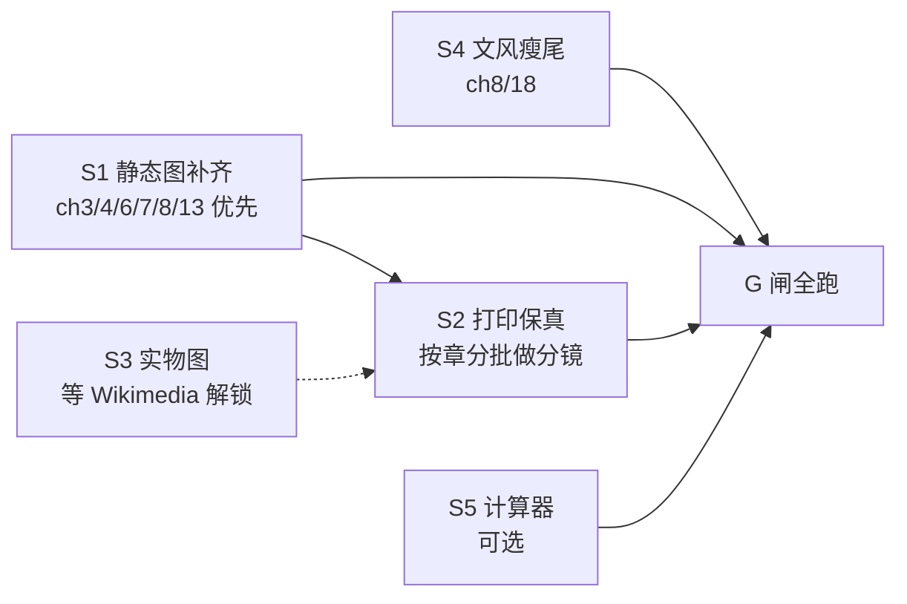

# v4 彻底改造计划（Spec）

状态：**待评审**。定稿日期 2026-11-02，基线 v3.81 提交点（本地 main，领先 origin 3 个提交）。
本文是改造前的规格书：先对齐目标、证据与验收闸，再动工。`docs/` 仍是唯一内容权威源；本文件只做规划，不引入内容。

---

## 0. 目标与一句话定义

把这本 19 章模拟电路书从「文字合格、视觉参差」推到「**每个核心概念都有图、每张图都有话、每个介质都不丢信息**」的教科书水准——生动形象、浅显易懂、无 AI 味、人人可读，且屏幕与纸张两种读法都成立。

「彻底」= 改三件事，不改方向：

1. **静态视觉密度达标**——按正文长度配足实物图与手绘分析图，消灭低密度章；
2. **动画的叙事在纸面上可存活**——打印版不再静默丢掉节拍说明与关键帧；
3. **图与话互相咬合**——每图前有提问、后有含数字的读图指引，图中数字必须出自本章正文。

## 1. 基线证据（动工前实测，非估计）

| 维度 | 实测值 | 问题 |
|---|---|---|
| 全书规模 | 19 章，714,036 字符（BOOK.md），16K 两卷 448+508 页 | 硬上限 700 页/卷，余量不大 |
| 静态图（手绘分析图） | 39 张，`assets/figures/` | 章节分布不均：ch3/4/6/7/13 各 1~2 张 |
| 实物照片 | 25 张已授权（credits 已登记），25 处章节引用（v3.81 二波后全部入位） | ch7/11/14 引用为 0；新增获取被 Wikimedia 403/429 封锁 |
| 原理动画 | 118 张 SMIL，`assets/svg/` | 动画回填链接 128 处，ch16/17/18 各仅 3~4 |
| 交互计算器 | 7 章有 `data-calc`，共 8 处埋点（ch11 两处） | ch2/3/4/5/8/9/10/12/14/15/17/18 无 |
| 视觉密度（静态图+照片/万字） | 中位 1.36；最低 ch8=0.78、ch7=0.86、ch13=0.95 | 高密度章 ch16=2.44，落差 3 倍 |
| **打印版动画信息丢失** | 118 张中 **112 张经 `svg_refine` 后 `<text>` 减少**，平均仅保留 81%；节拍说明（caption）整体被剥掉 | 纸张读者看不到动画要讲的故事——目前最大的单点缺口 |
| 文风 | 公式化短语 0 命中；句长离差 SD≈54（人写参照 ~34）；残留「不是…而是」44 处 | 残留聚类集中在 ch2/8/18 |

## 2. 范围（Scope）

### 2.1 做

- **S1 静态图补齐**：为每章把「静态图+照片」密度拉到 ≥1.5/万字或 ≥3 张（取先到者），低密度章（ch3/4/6/7/8/13）优先。新增手绘图走既有契约（960 宽、五主色、≥6 text、无禁项、画布内文字）。
- **S2 打印保真（核心）**：为依赖节拍叙事的动画生成**静态多格分镜图**（同一 SVG 按节拍拆 3~5 格），印刷版引用分镜、网页版引用动画，一处源、两处渲染。起点：112 张丢文本的动画按章节优先级分批。
- **S3 实物图扩容（条件解锁）**：Wikimedia 封锁解除后，补拍/补引：ch7（比较器芯片）、ch11（功放散热器）、ch14（射频器件）；以及仪表实测照（示波器波形、万用表读数）替代纯文字读数。**授权不伪造，宁可留位待补。**
- **S4 文风二段瘦尾**：只清聚类残留——ch2 已瘦身，继续 ch8/ch18 的「不是…而是」；不设新指标，现有离差与短语扫描即为验收。
- **S5 计算器覆盖（可选扩展）**：ch12（环路补偿）、ch8（采样保持误差预算）、ch5（开关损耗）各补一个，必须自带打印回退（±1600 字符规则）。

### 2.2 不做（明确排除）

- 不新增章节、不动 19 章结构与 L0–L3 分级；
- 不动 700 页硬上限、纸型、版心；
- 不换视觉风格（FA-029 + 纸墨色板已固化在 HANDRAW-STYLE.md 与测试里）；
- 不把 AI 审读升级为人工终审表述；
- 不引入需要网络的资源（离线铁律）。

## 3. 完成检查（每个闸都可跑、可证伪）

| 闸 | 命令/证据 | 通过条件 |
|---|---|---|
| G1 契约回归 | `python -B -m unittest discover -s scripts -p "test_*.py"` | 全绿；新增图全过 `test_figures.py` 四测（含画布内文字探针） |
| G2 密度达标 | 复跑本文件 §1 的密度脚本 | 每章 ≥1.5/万字或 ≥3 张；最低章不再低于中位数一半 |
| G3 打印保真 | 对每批 S2 图：`refine_svg` 后 `<text>` 数不降；分卷 PDF 构建 0 警告、各 ≤700 页 | 112 张丢文本清单清零 |
| G4 图话咬合 | 抽查每新图：前段有提问、后段含至少 1 个图中数字的回指 | 人读可复述图意 |
| G5 同步 | `build_readme.py` / `build_site.py --build` / `build_book_data.py --write --check` 全过，`git status` 干净 | 派生物与 `docs/` 一致 |
| G6 授权链 | 每张新照片在 `docs/p9-14-credits.md` 有来源+授权行 | 零伪造 |
| G7 浏览器 | `test-browser` 六件全过（动画在页面真实渲染） | 无回归 |

## 4. 分批与依赖

- **顺序**：S1 先行（纯增量、风险最低、立刻可见）；S2 是主工程，跟在 S1 后吃同一批图号与正文锚点；S4 随时可插入；S3 纯外部依赖，解锁即做；S5 最后。
- **并发规则**：图类批次继续用「写盘优先、逐章交付、不跑全局测试、不提交」的子代理契约；`test_figures.py` 只在主代理集中跑（全局断言，并发不可靠）。
- **每批交付即验证**：图契约测试 + `test_docs_links.py` + 窄章测试，再进下一批。

## 5. 风险与对策

| 风险 | 对策 |
|---|---|
| 分镜图把 16K 页数顶破 700/卷 | S2 先做一卷试点，量出页数增量再定全量节奏；必要时分镜只覆盖「丢文本 >15%」的动画 |
| 子代理图违反契约（越界/禁项/多引） | 已有永久防线 `test_text_stays_inside_the_canvas`；每批集中跑 |
| 主题撞车（已发生：交越失真 vs demo9） | 新动画/新图先查 `assets/svg` 与 part5 索引再立项 |
| Wikimedia 长期不解锁 | S3 不阻塞主链；留位待补，不在正文悬空引用 |
| 文风修改破坏既定语感 | 只动聚类残留，每改一处跑短语扫描确认不新增 |

## 6. 当前进度对接

v3.80/v3.81 已落地：39 静态图、118 动画、8 张新照片入位、永久越界探针、两新动画（地弹/三触点）。**本 spec 不推翻这些，只把剩余缺口（密度尾、打印丢帧、实物图、文风瘦尾）显式排程。**

落地顺序建议：**先合 v3.81（当前未提交的二波改动）→ 再按 §4 启动 S1。** 本文件随 v3.81 一并提交，作为改造的对齐基线。
