# C 组：77 张签名失效回落图（WIP 重渲未重审，已按闸规回落 generated）

来源：CI「视觉资产契约与合成管线」红 → test_papercut_figures 发现 77 张 accepted 图字节与审签 sha 不符
（WIP 重渲这些纸墨图但未重审；合并绕过了 register() sha 闸）。处理：status 回落 generated + 清 review 字段
（与 register() 语义一致）；被签字节仍在 origin/main 可对照。

| 子组 | 张数 | 性质 |
|---|---|---|
| C1 文本未变·图形待目审 | 71 | SVG 可见文本集与签名版一致；像素差成因（皮肤/几何/叠放/标注归属）需新旧并置目审，不得由文本相等推定 |
| C2 文本有变 | 6 | 数值/文字集变化，逐条列 numΔ，对照散文与数字保全审计过目 |

> 签核方式同 index.md：回列 accepted id，代理翻转 status 并补 review_record（新 sha + 评分）。

## C1 文本未变·图形待目审
### ch01-q-selectivity-map  ☐

当前：
签名版：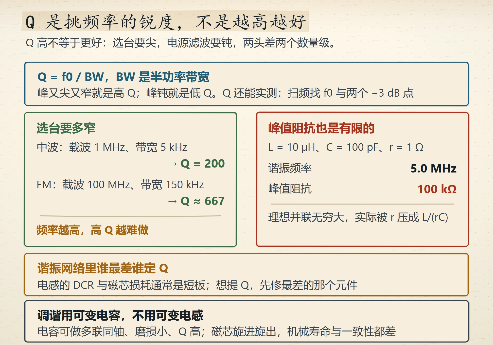

- 章·锚：1·1.5 ｜ 像素 diff vs 签名版：0.00%
- alt：手绘品质因数两栏。顶部蓝框给定义：Q 等于谐振频率除以半功率带宽，峰又尖又窄是高 Q；Q 还能实测，扫频找谐振峰与两个下降 3 分贝的点。左绿框按给定半功率带宽计算：中波载波 1 兆赫、带宽 5 千赫，Q 等于 200；调频载波 100 兆赫、带宽 150 千赫，Q 约 667；频率越高做出高 Q 越难，损耗与寄生随频率一起涨。右红框峰值阻抗也是有限的：电感 10 微亨、电容 100 皮法、电阻 1 欧，谐振频率 5.0 兆赫，峰值阻抗 100 千欧；理想并联回路阻抗无穷大，实际被电感电阻压成电感除电阻乘电容。下方琥珀框写谐振网络里谁最差谁定 Q，电感的直流电阻与磁芯损耗通常是短板。底部写调谐用可变电容不用可变电感：电容可做多联同轴、磨损小、Q 高。
- source_facts：docs/p1-02-ch1.md#1.5

### ch02-bridge-junction-ledger  ☐

当前：
签名版：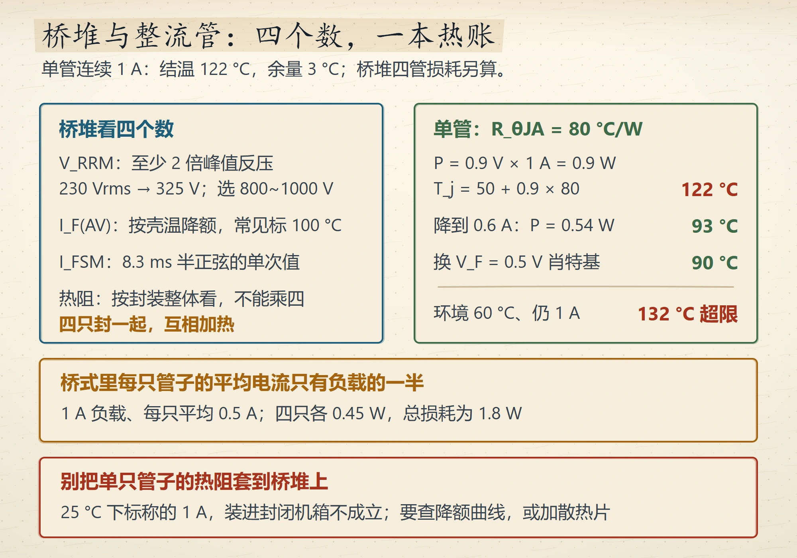

- 章·锚：2·2.12 ｜ 像素 diff vs 签名版：0.00%
- alt：手绘桥堆两栏加热账。左蓝框桥堆看四个数：反向耐压至少 2 倍峰值反压，市电 230 伏有效值峰值 325 伏，所以按两倍余量选 800 到 1000 伏；平均电流要按壳温降额，常见标 100 摄氏度；浪涌电流是 8.3 毫秒半正弦的单次值；热阻要按封装整体看，不能拿单只乘四，四只封在一起互相加热。右绿框单管连续导通的结温账，热阻按 80 摄氏度每瓦：功耗 0.9 伏乘 1 安得 0.9 瓦，结温 50 加 0.9 乘 80 得 122 摄氏度；降到 0.6 安功耗 0.54 瓦，结温 93 摄氏度；换 0.5 伏肖特基，90 摄氏度；环境升到 60 摄氏度仍 1 安，132 摄氏度已经超限。下方琥珀框写桥式里每只管子的平均电流只有负载的一半：1 安负载每只导通半周、平均 0.5 安，四只各 0.45 瓦、总损耗为 1.8 瓦。底部红框写别把单只管子的热阻套到桥堆上，25 摄氏度下标称的 1 安装进封闭机箱不成立。
- source_facts：docs/p1-03-ch2.md#2.12

### ch02-esd-chain  ☐

当前：
签名版：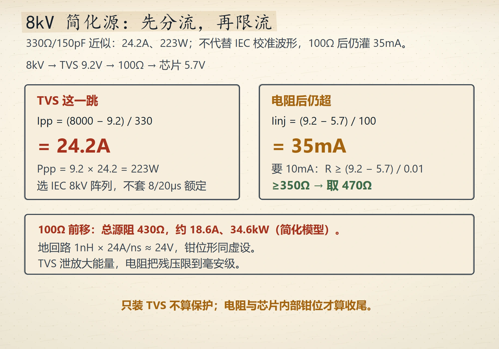

- 章·锚：2·2.11.3 ｜ 像素 diff vs 签名版：0.00%
- alt：8 千伏简化 RC 源：330 欧、150 皮法，不代替 IEC 校准波形；TVS 钳到 9.2 伏，估算 24.2 安、223 瓦。100 欧后向芯片注入 35 毫安；10 毫安目标需至少 350 欧，选 470 欧。100 欧前移时总源阻 430 欧，约 18.6 安、34.6 千瓦。地回路 1 纳亨乘 24 安每纳秒产生 24 伏压降。
- source_facts：docs/p1-03-ch2.md#2.11.3

### ch02-rectifier-voltage-ledger  ☐

当前：
签名版：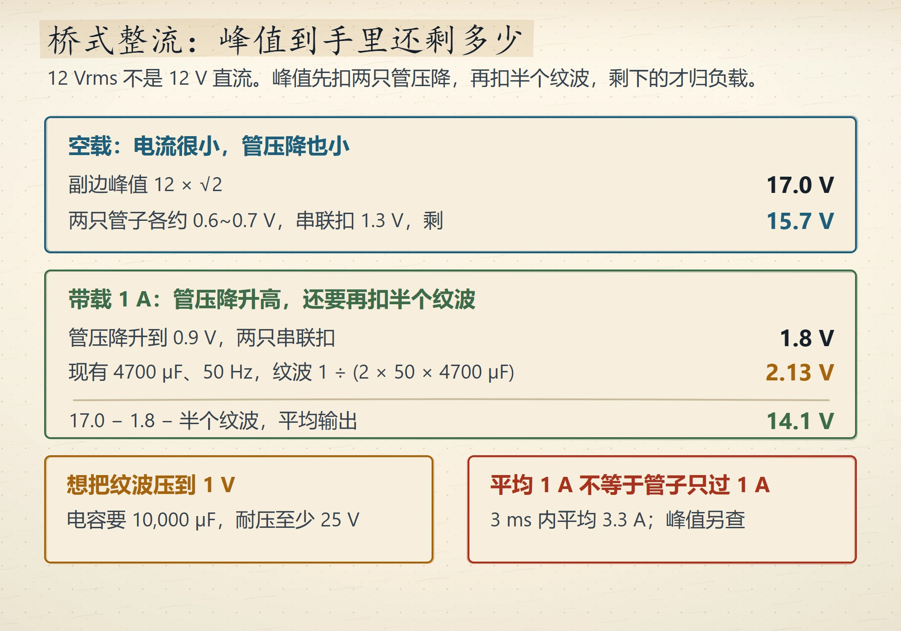

- 章·锚：2·2.10 ｜ 像素 diff vs 签名版：0.00%
- alt：手绘桥式整流电压分账。上面蓝框空载：副边峰值 12 乘根号 2 得 17.0 伏，两只管子各约 0.6 到 0.7 伏、串联扣 1.3 伏，剩 15.7 伏。中间绿框带载 1 安：管压降升到 0.9 伏、两只串联扣 1.8 伏，现有 4700 微法配 50 赫兹，纹波等于 1 除以 2 乘 50 乘 4700 微法得 2.13 伏，17.0 减 1.8 再减半个纹波，平均输出 14.1 伏。左下琥珀框写想把纹波压到 1 伏，电容要 10,000 微法、耐压至少 25 伏；右下红框写负载平均 1 安不等于管子只过 1 安，导通只占 3 毫秒，窗口平均 3.3 安；实际峰值须另查脉形。
- source_facts：docs/p1-03-ch2.md#2.10

### ch03-ce-swing-budget  ☐

当前：
签名版：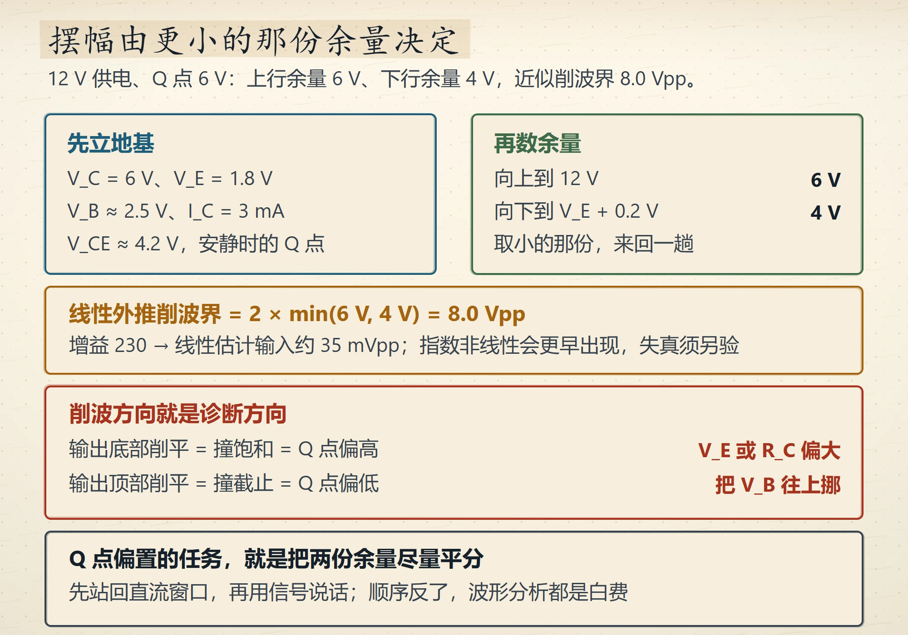

- 章·锚：3·3.9 ｜ 像素 diff vs 签名版：0.00%
- alt：手绘共射摆幅预算。左蓝框先立地基：集电极 6 伏、发射极 1.8 伏、基极约 2.5 伏、集电极电流 3 毫安、管压降约 4.2 伏，这是安静时的 Q 点。右绿框再数余量：向上到 12 伏是 6 伏，向下到发射极加 0.2 伏是 4 伏，取小的那份。琥珀框写线性外推削波界等于 2 乘最小余量、即 8.0 Vpp；增益 230，线性估计输入约 35 mVpp；指数非线性更早出现，失真须另验。红框写削波方向就是诊断方向：输出底部削平是撞饱和、Q 点偏高，查发射极电压或集电极电阻偏大；顶部削平是撞截止、Q 点偏低，把基极电压往上挪。底部写 Q 点偏置的任务就是把两份余量尽量平分，先站回直流窗口再用信号说话。
- source_facts：docs/p1-04-ch3.md#3.9

### ch03-config-impedance  ☐

当前：
签名版：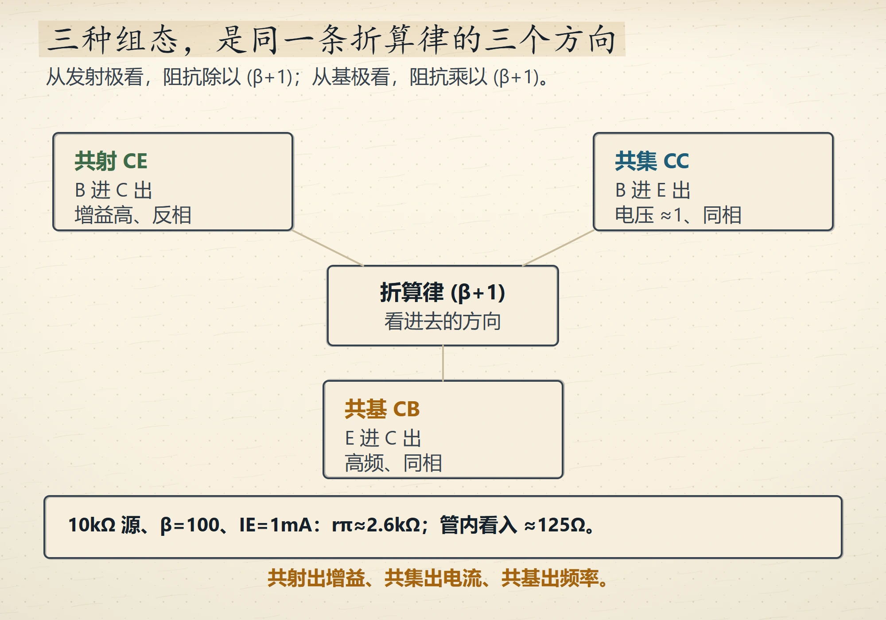

- 章·锚：3·3.3 ｜ 像素 diff vs 签名版：0.00%
- alt：手绘三种组态与阻抗折算律：共射反相放大，共集同相缓冲，共基输入阻抗低。从发射极看，基极回路阻抗除以贝塔加一。10 千欧源、贝塔 100、IE 1 毫安、rπ 约 2.6 千欧，从发射极看入管内约 125 欧，端口还须并联发射极电阻。
- source_facts：docs/p1-04-ch3.md#3.3

### ch03-region-check  ☐

当前：
签名版：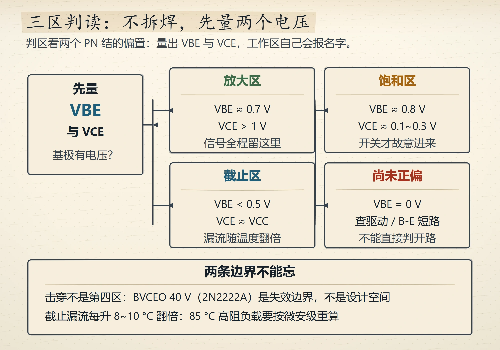

- 章·锚：3·3.2 三个工作区（判断方法是看两个 PN 结的偏置） ｜ 像素 diff vs 签名版：0.00%
- alt：判读流程：先量 VBE 与 VCE，再分四路——VBE 约 0.7 V、VCE 大于 1 V 是放大区；VBE 约 0.8 V、VCE 约 0.1~0.3 V 是饱和区；VBE 小于 0.5 V、VCE 接近 VCC 是截止区；VBE 为 0 V 说明尚未正偏，应查驱动或 B-E 短路，不能直接判开路。底部两条边界：BVCEO 40 V 是失效边界不是第四区；截止漏流每升 8~10 °C 翻倍，85 °C 高阻负载要重算。
- source_facts：docs/p1-04-ch3.md#3.2 三个工作区（判断方法是看两个 PN 结的偏置）

### ch04-channel-formation  ☐

当前：
签名版：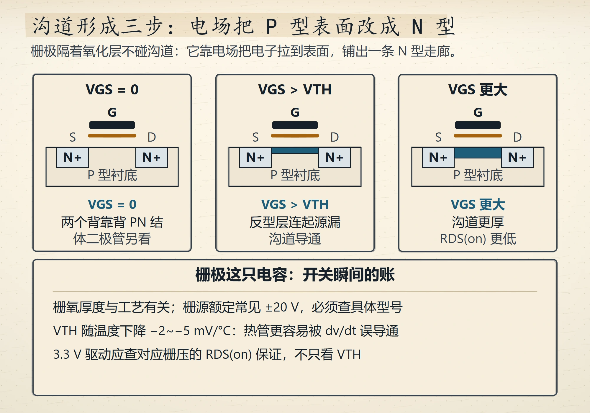

- 章·锚：4·4.1 沟道形成原理（N 沟道增强型） ｜ 像素 diff vs 签名版：0.00%
- alt：三幅 N 沟道增强型 MOSFET 剖面：VGS=0 时两个 N+ 区被 P 型衬底隔开、增强沟道关闭，体二极管另看极性；VGS>VTH 时氧化层下形成蓝色反型层，把源漏连起来；VGS 更大时沟道更厚、RDS(on) 更低。底部三条电容账：栅氧厚度取决于工艺，栅源额定常见 ±20 V、须查型号；VTH 随温度下降 −2~−5 mV/°C；3.3 V 驱动要查对应栅压的 RDS(on) 保证，不能只看 VTH(max)。
- source_facts：docs/p1-05-ch4.md#4.1 沟道形成原理（N 沟道增强型）

### ch04-deadtime-ledger  ☐

当前：
签名版：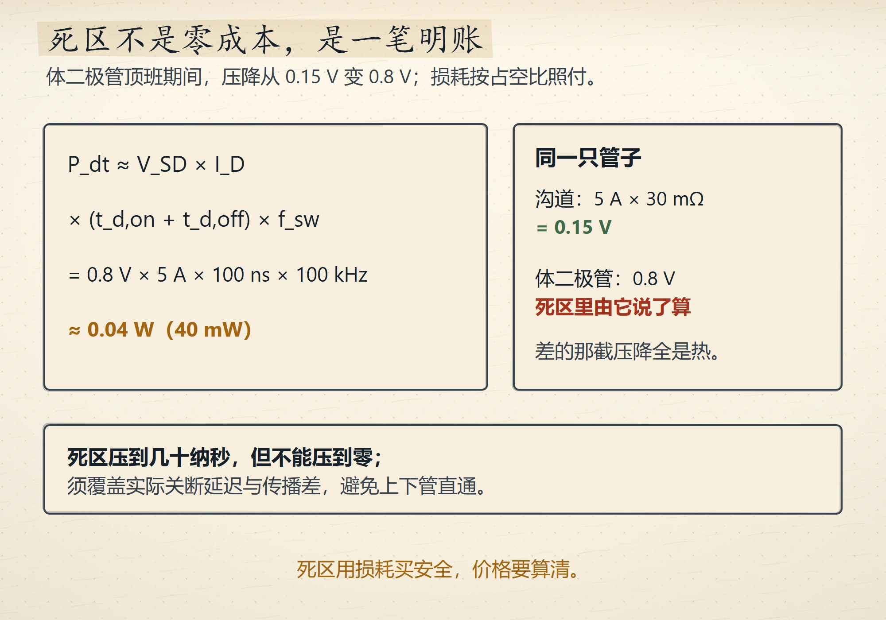

- 章·锚：4·4.4 ｜ 像素 diff vs 签名版：0.00%
- alt：手绘公式与对照：每周期两段死区合计 100 纳秒，死区损耗等于 0.8 伏乘 5 安乘 100 纳秒乘 100 千赫，约 0.04 瓦即 40 毫瓦；同一只管子沟道压降 5 安乘 30 毫欧为 0.15 伏，体二极管为 0.8 伏。死区须覆盖实际关断延迟，不能按零设置。
- source_facts：docs/p1-05-ch4.md#4.4

### ch04-output-regions  ☐

当前：
签名版：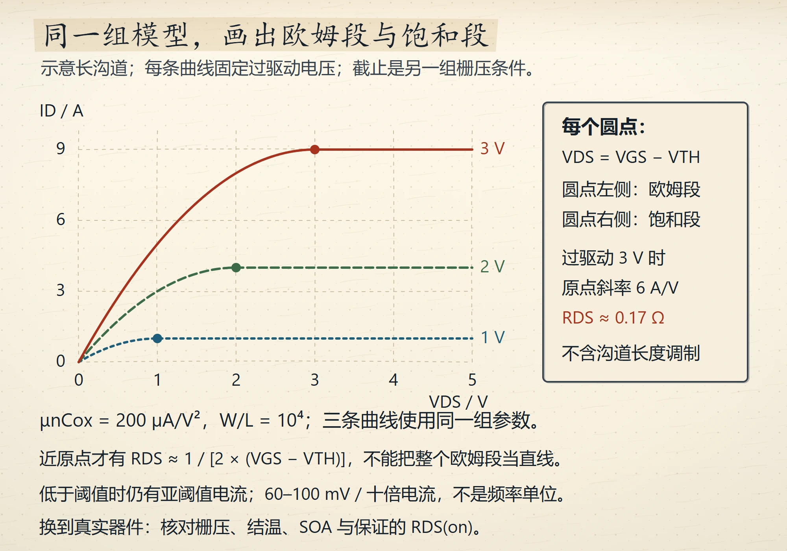

- 章·锚：4·4.2 ｜ 像素 diff vs 签名版：0.00%
- alt：同一长沟道模型的三条输出曲线，过驱动一、二、三伏，夹断点分别在漏压一、二、三伏。过驱动三伏时原点斜率六安每伏，对应约零点一七欧；欧姆段并非全程直线，饱和电流分别为一、四、九安。
- source_facts：docs/p1-05-ch4.md#4.2

### ch04-switching-energy-ledger  ☐

当前：
签名版：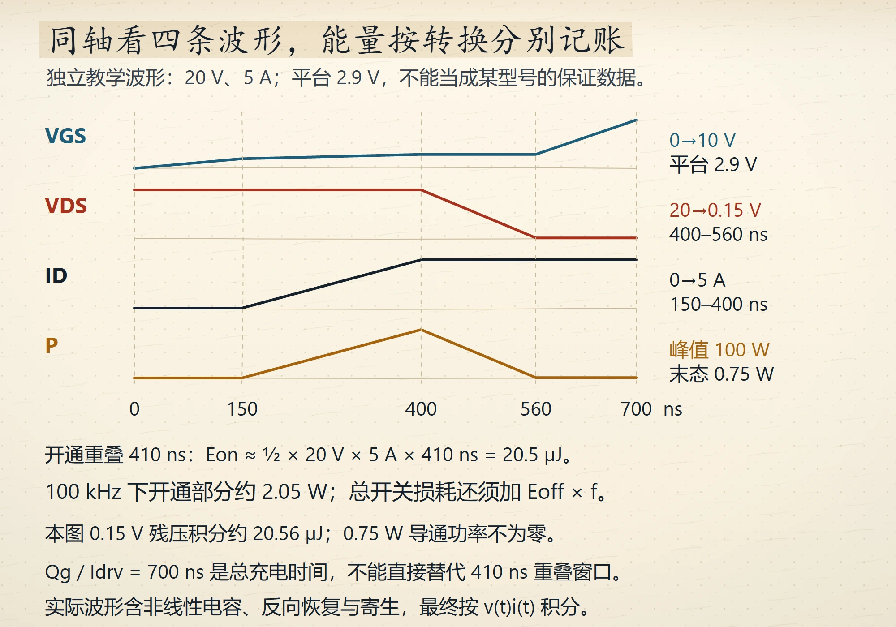

- 章·锚：4·4.6 ｜ 像素 diff vs 签名版：0.00%
- alt：四条波形共用纳秒时间轴。电流在一百五十至四百纳秒上升，漏压在四百至五百六十纳秒下降；开通重叠四百一十纳秒，三角近似二十点五微焦，一百千赫下约二点零五瓦，仅是开通部分。导通末态仍有零点七五瓦。
- source_facts：docs/p1-05-ch4.md#4.6

### ch04-thermal-chain-ledger  ☐

当前：
签名版：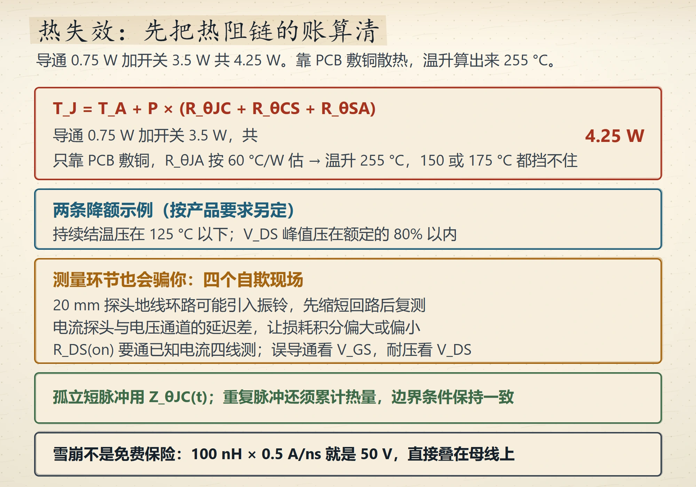

- 章·锚：4·4.5 ｜ 像素 diff vs 签名版：0.00%
- alt：手绘热失效账。顶部红框写结温等于环境温度加功耗乘三级热阻之和；导通 0.75 瓦加开关 3.5 瓦共 4.25 瓦，只靠电路板敷铜、热阻按 60 摄氏度每瓦估，温升 255 摄氏度，150 或 175 摄氏度的额定都挡不住。蓝框两条降额示例：结温 125 摄氏度以下、漏源峰值在额定 80% 以内，具体按产品要求另定。琥珀框列测量边界：20 毫米探头地线环路可能引入振铃，先缩短后复测；电流探头与电压通道的延迟差让损耗积分偏大或偏小；导通电阻要通已知电流四线测；误导通看栅源电压与热态阈值，耐压看漏源峰值。绿框写孤立短脉冲看瞬态热阻，重复脉冲还须累计热量，保持相同热边界条件。底部写雪崩不是免费保险：100 纳亨乘 0.5 安每纳秒就是 50 伏，直接叠在母线上。
- source_facts：docs/p1-05-ch4.md#4.5

### ch05-ab-bias-thermal  ☐

当前：
签名版：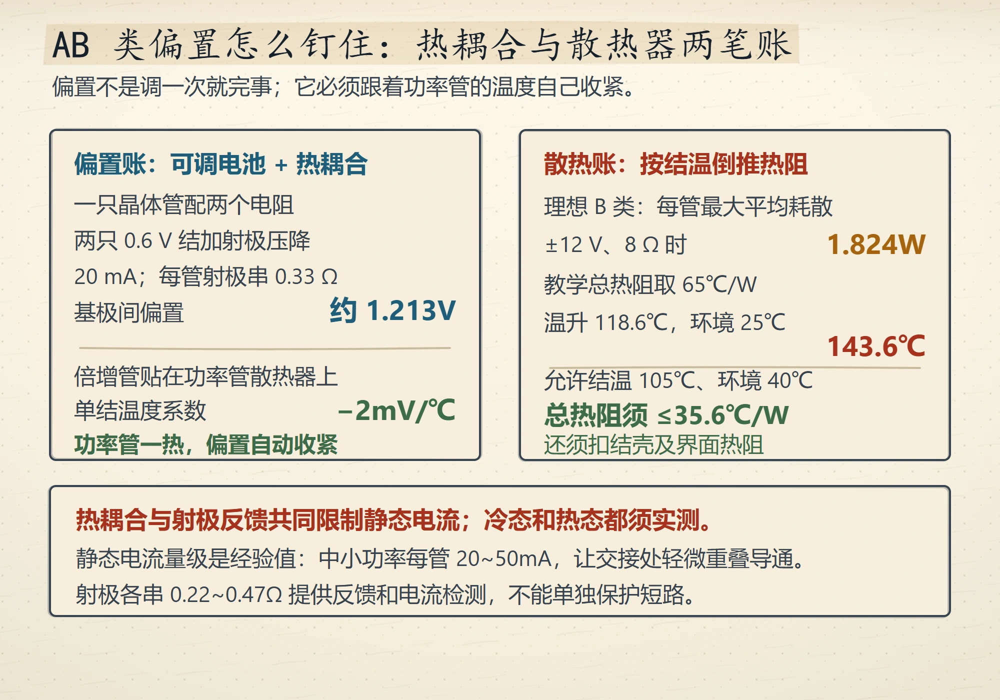

- 章·锚：5·5.6 ｜ 像素 diff vs 签名版：0.00%
- alt：单结互补射随器的偏置为两只零点六伏结压降加射极电阻压降，二十毫安、两只零点三三欧合计约一点二一三伏。正负十二伏、八欧理想 B 类每管最大耗散一点八二四瓦；热阻六十五摄氏度每瓦、环境二十五度，结温约一百四十三点六度。
- source_facts：docs/p1-06-ch5.md#5.6

### ch05-open-drain-rise  ☐

当前：
签名版：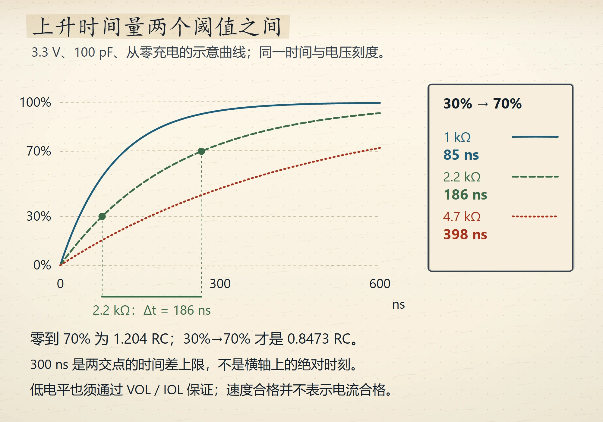

- 章·锚：5·5.2 ｜ 像素 diff vs 签名版：0.00%
- alt：三点三伏、一百皮法的 RC 充电曲线，分别使用一千欧、二点二千欧和四点七千欧。上升时间从百分之三十到百分之七十测量，约八十五、一百八十六和三百九十八纳秒；二点二千欧曲线标出两个交点。
- source_facts：docs/p1-06-ch5.md#5.2

### ch05-rp-power  ☐

当前：
签名版：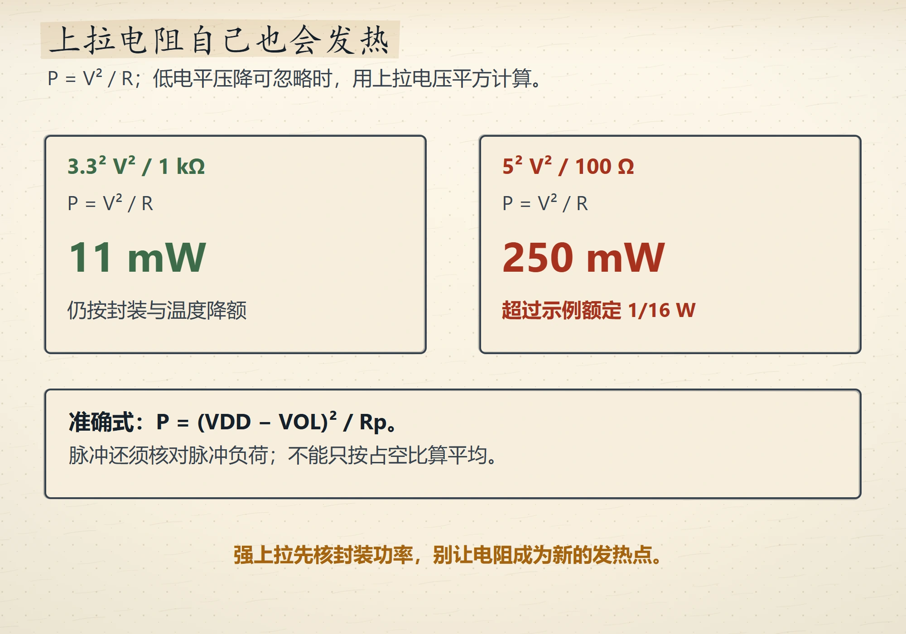

- 章·锚：5·5.2 ｜ 像素 diff vs 签名版：0.00%
- alt：上拉电阻功率用电压平方除以电阻。低电平近零时三点三伏、一千欧约十一毫瓦；五伏、一百欧为二百五十毫瓦，超过示例四零二封装的十六分之一瓦额定。核对温度和脉冲负荷。
- source_facts：docs/p1-06-ch5.md#5.2

### ch05-shoot-through-ledger  ☐

当前：
签名版：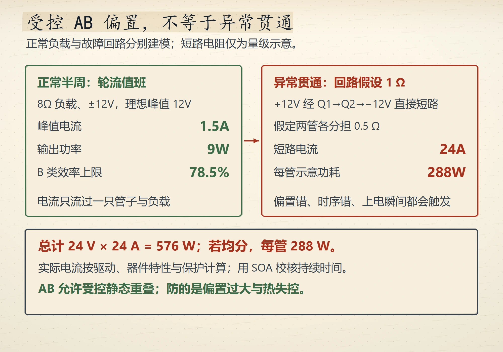

- 章·锚：5·5.6 ｜ 像素 diff vs 签名版：0.00%
- alt：正常理想 B 类输出峰值一点五安、负载九瓦；故障假设二十四伏跨在一欧回路上，二十四安，总功率五百七十六瓦。若两管均分，每管二百八十八瓦，实际按驱动、保护和 SOA 核查。AB 类允许受控静态重叠。
- source_facts：docs/p1-06-ch5.md#5.6

### ch05-tristate-handover  ☐

当前：
签名版：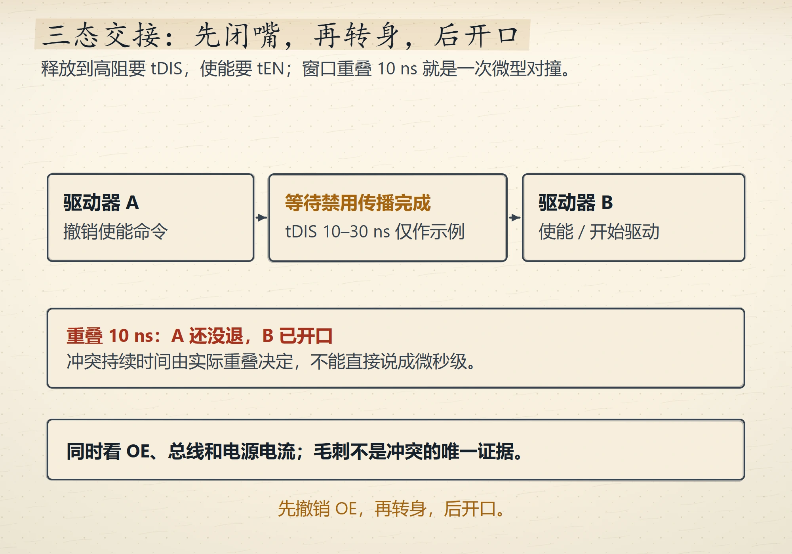

- 章·锚：5·5.4 ｜ 像素 diff vs 签名版：0.00%
- alt：先禁用 A，等待实际禁用传播完成，再切方向和使能 B。禁用传播不等于无驱动空档；重叠十纳秒表示两路同时驱动十纳秒，须同时测使能、总线和电源电流。
- source_facts：docs/p1-06-ch5.md#5.4

### ch06-741-four-blocks  ☐

当前：
签名版：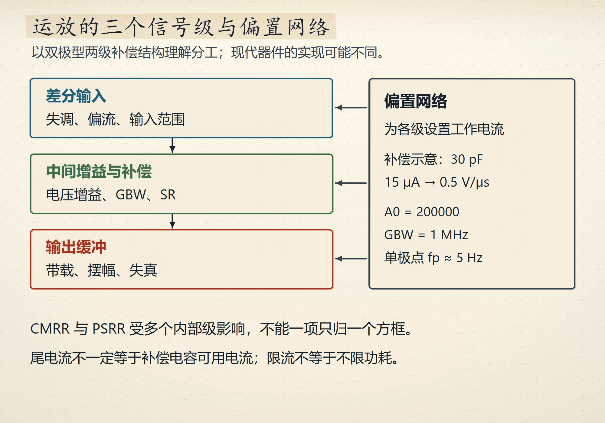

- 章·锚：6·6.1 ｜ 像素 diff vs 签名版：0.00%
- alt：三个信号级的箭头依次连接输入、中间和输出。偏置网络从侧面供给电流；补偿单极点教学数值互相一致。
- source_facts：docs/p1-07-ch6.md#6.1

### ch06-bias-balance  ☐

当前：
签名版：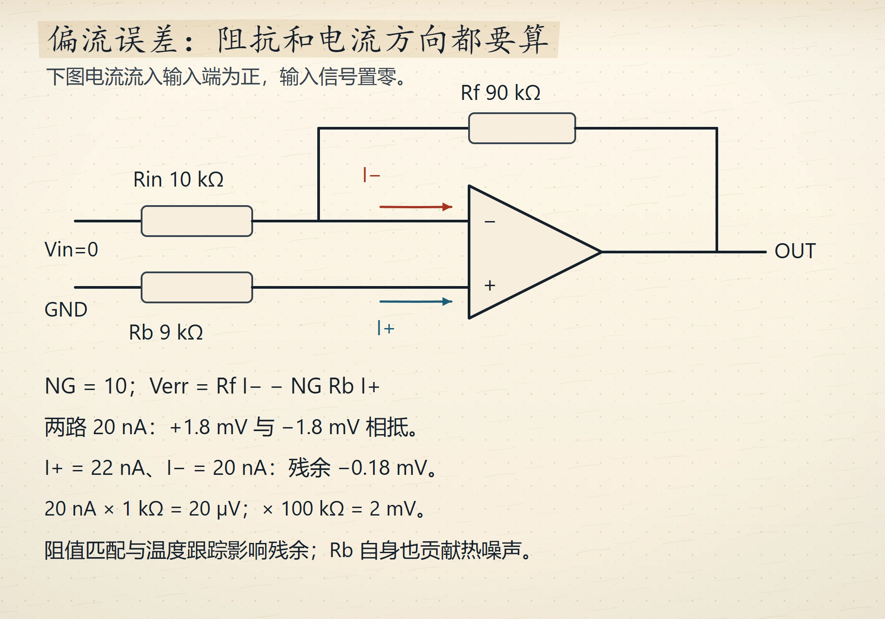

- 章·锚：6·6.3 ｜ 像素 diff vs 签名版：0.00%
- alt：二十纳安流过一千欧为二十微伏，十万欧为二毫伏。反相输入电阻十千欧、反馈九十千欧，平衡九千欧时匹配偏流抵消；二纳安失配留下零点一八毫伏。
- source_facts：docs/p1-07-ch6.md#6.3

### ch06-fault-conditions  ☐

当前：
签名版：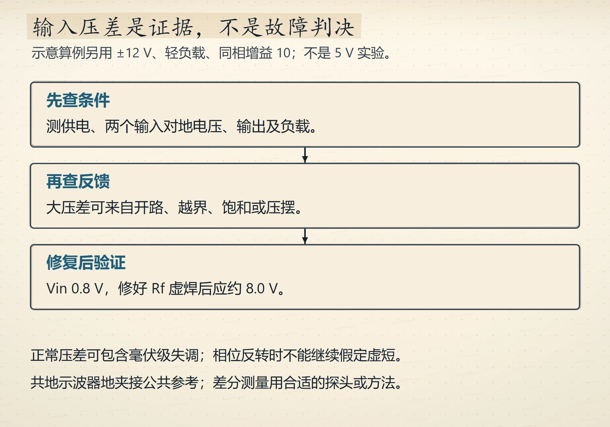

- 章·锚：6·6.6 ｜ 像素 diff vs 签名版：0.00%
- alt：三步流程检查供电共模负载、反馈通路和修复验证。另用正负十二伏供电，同相十倍把零点八伏放大到八伏；大压差不能唯一归因于反馈断路。
- source_facts：docs/p1-07-ch6.md#6.6

### ch06-opamp-conditions  ☐

当前：
签名版：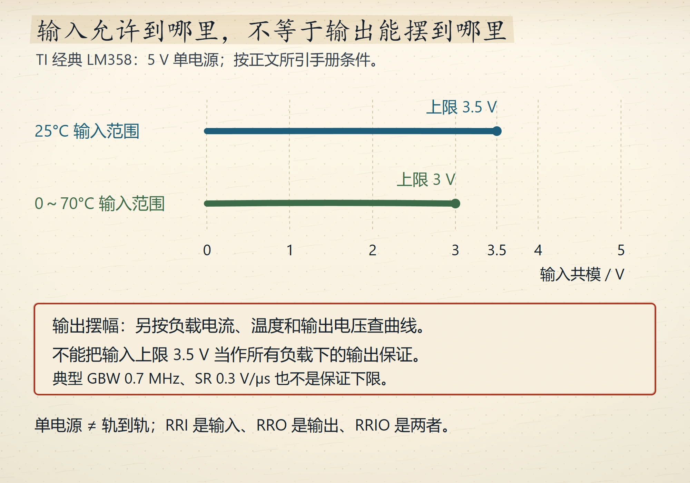

- 章·锚：6·6.2 ｜ 像素 diff vs 签名版：0.00%
- alt：五伏供电下，经典 LM358 输入共模范围在二十五摄氏度上限为三点五伏，零到七十摄氏度留到三伏。两条范围条共享电压轴；输出摆幅另查负载与温度条件，不能照搬输入范围。
- source_facts：docs/p1-07-ch6.md#6.2

### ch06-slew-vs-gbw  ☐

当前：
签名版：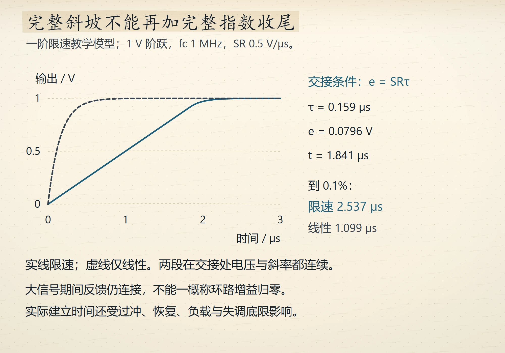

- 章·锚：6·6.7 ｜ 像素 diff vs 签名版：0.00%
- alt：限速实线和仅线性虚线共享时间电压轴；一伏阶跃在一点八四一微秒交接，剩余误差零点零七九六伏；千分之一建立时间约二点五三七微秒。
- source_facts：docs/p1-07-ch6.md#6.7

### ch07-delay-endpoints  ☐

当前：
签名版：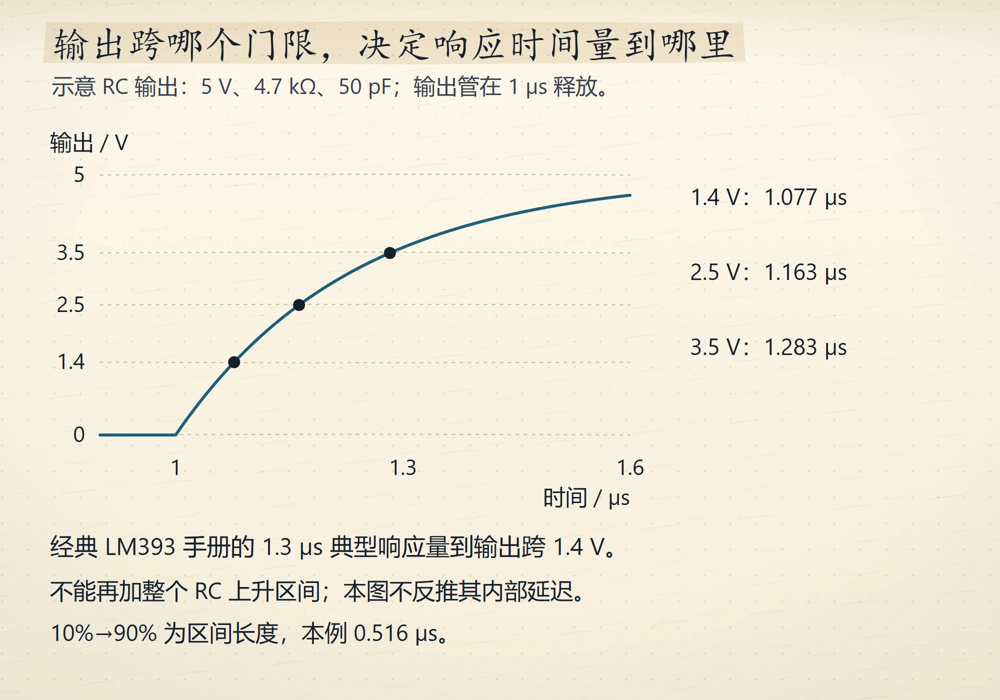

- 章·锚：7·7.1 ｜ 像素 diff vs 签名版：0.00%
- alt：示意 RC 充电曲线上，输出越过一点四伏、二点五伏和三点五伏的时刻不同；手册指定的响应终点不能再加完整上升区间。
- source_facts：docs/p1-08-ch7.md#7.1

### ch07-glitch-margin  ☐

当前：
签名版：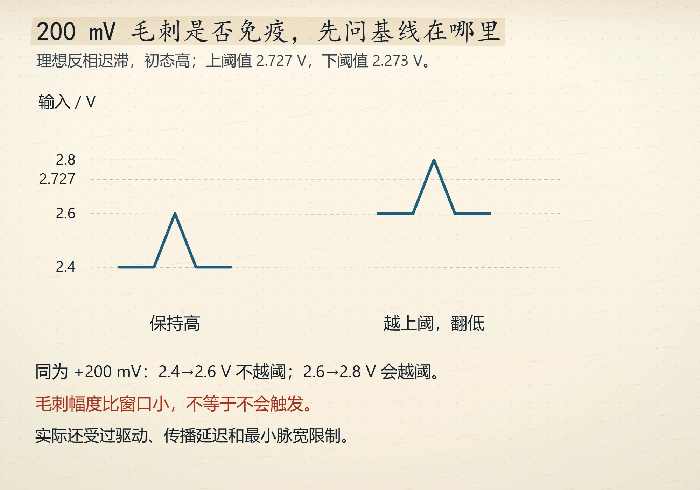

- 章·锚：7·7.5 ｜ 像素 diff vs 签名版：0.00%
- alt：同样二百毫伏毛刺，基线二点四伏时不超过二点七二七伏门限，基线二点六伏时越阈翻转；是否触发取决于当前状态和门限距离。
- source_facts：docs/p1-08-ch7.md#7.5

### ch07-hysteresis-window  ☐

当前：
签名版：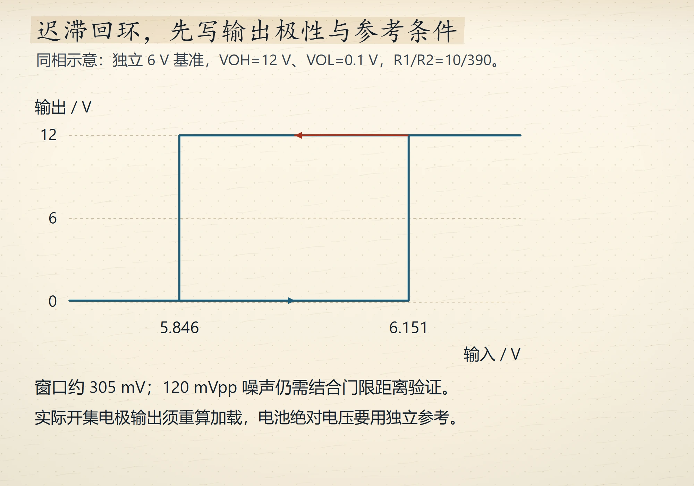

- 章·锚：7·7.3 ｜ 像素 diff vs 签名版：0.00%
- alt：独立六伏基准、理想输出十二伏与零点一伏，同相输入上行六点一五一伏翻高，下行五点八四六伏翻低；窗口约三百零五毫伏，非电池自身比例参考。
- source_facts：docs/p1-08-ch7.md#7.3

### ch07-pullup-three-accounts  ☐

当前：
签名版：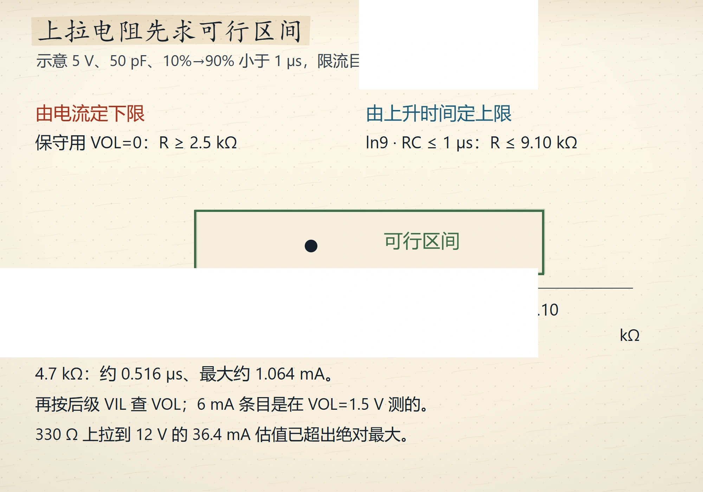

- 章·锚：7·7.2 ｜ 像素 diff vs 签名版：0.00%
- alt：五伏、五十皮法、上升小于一微秒且电流不超过二毫安，上拉取值区间约二点五到九点一千欧；四点七千欧回代合格还须核对低电平保证。
- source_facts：docs/p1-08-ch7.md#7.2

### ch07-threshold-budget  ☐

当前：
签名版：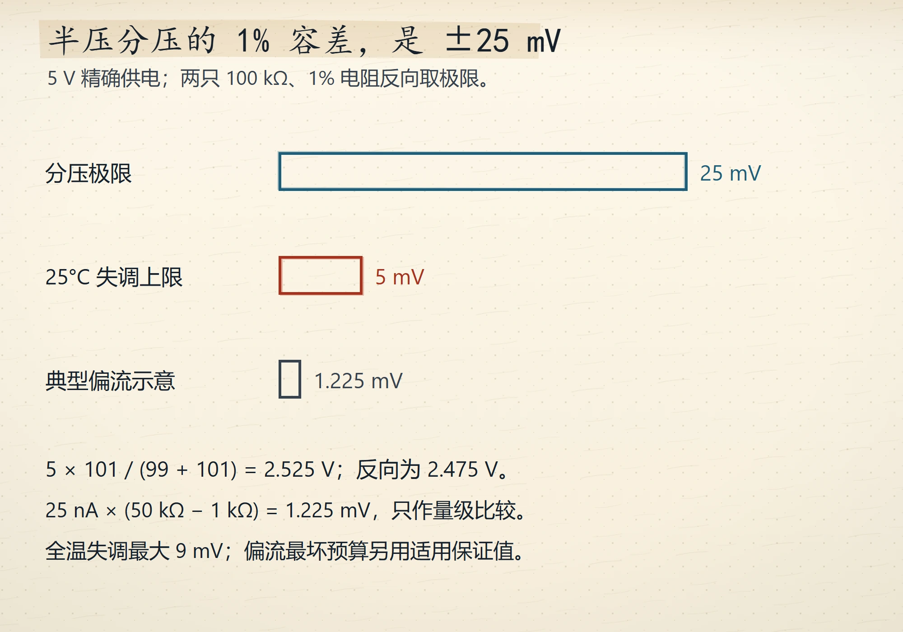

- 章·锚：7·7.2 ｜ 像素 diff vs 签名版：0.00%
- alt：五伏等值分压，两只百分之一电阻反向极限产生正负二十五毫伏；与五毫伏室温失调上限和一点二二五毫伏典型偏流示意分别比较。
- source_facts：docs/p1-08-ch7.md#7.2

### ch07-window-logic  ☐

当前：
签名版：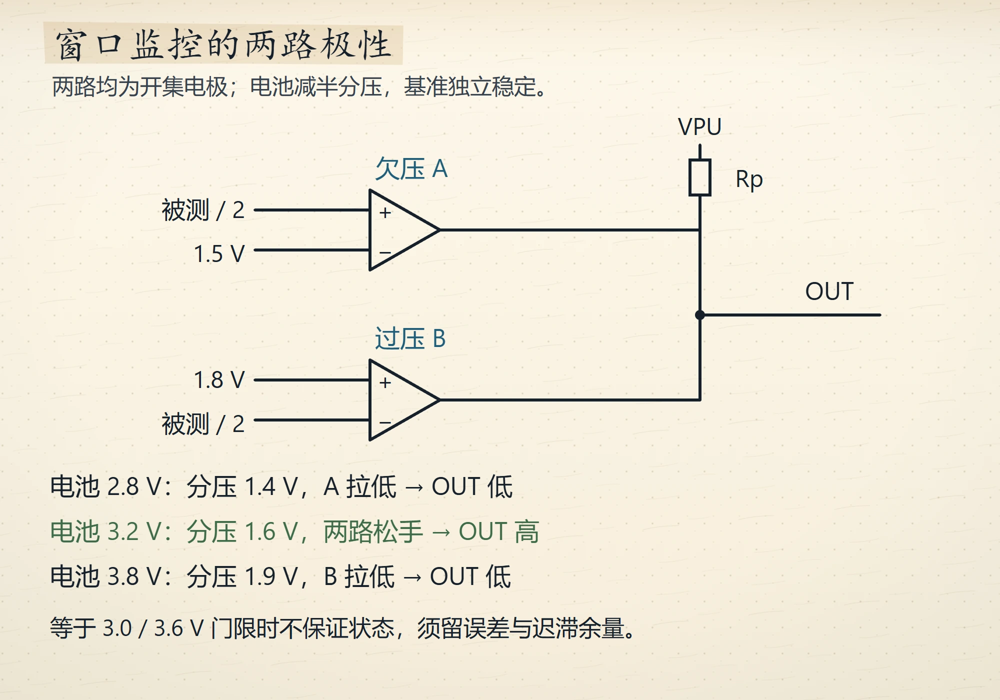

- 章·锚：7·7.2 ｜ 像素 diff vs 签名版：0.00%
- alt：欠压路被测进正端，过压路基准进正端；任一路越界都能拉低公共输出，窗口内两路松手。
- source_facts：docs/p1-08-ch7.md#7.2

### ch09-esr-window  ☐

当前：
签名版：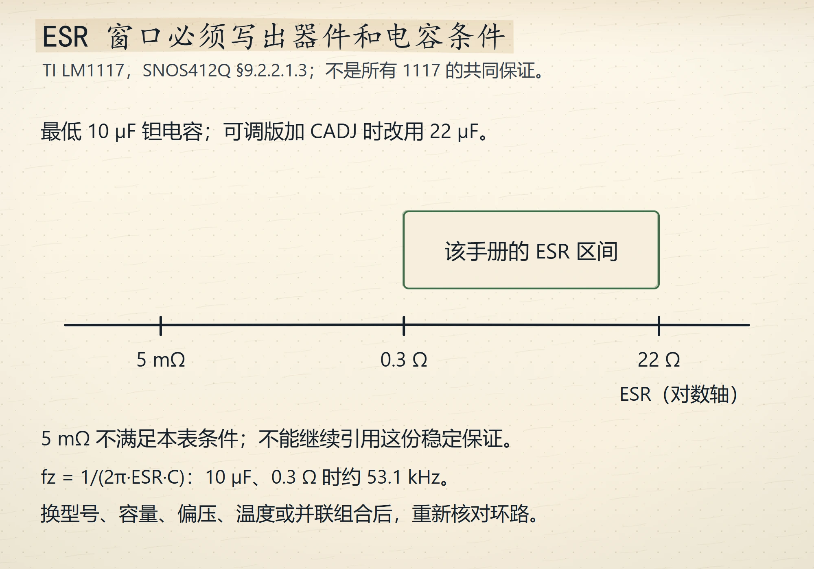

- 章·锚：9·9.3 ｜ 像素 diff vs 签名版：0.00%
- alt：零点三至二十二欧姆 ESR 区间明确绑定 TI LM1117 与钽电容条件，不能泛化为所有稳压器。
- source_facts：docs/p1-10-ch9.md#9.3

### ch09-ldo-four-accounts  ☐

当前：
签名版：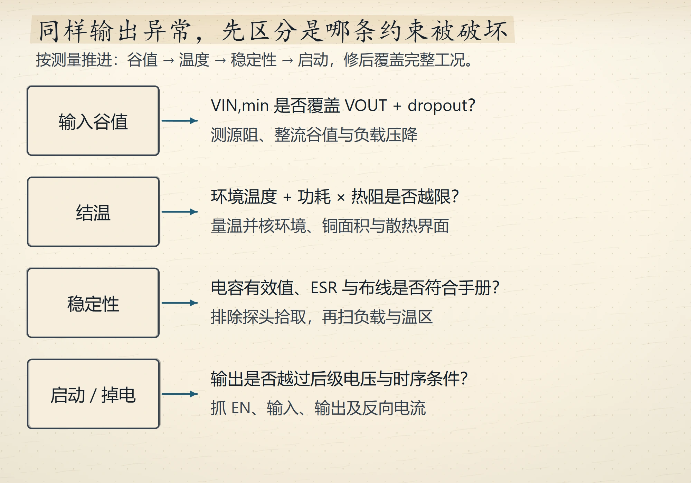

- 章·锚：9·9.4 ｜ 像素 diff vs 签名版：0.00%
- alt：依次检查输入谷值、结温、稳定性和启动掉电，各项都写出可验证条件和测量对象。
- source_facts：docs/p1-10-ch9.md#9.4

### ch09-load-transient  ☐

当前：
签名版：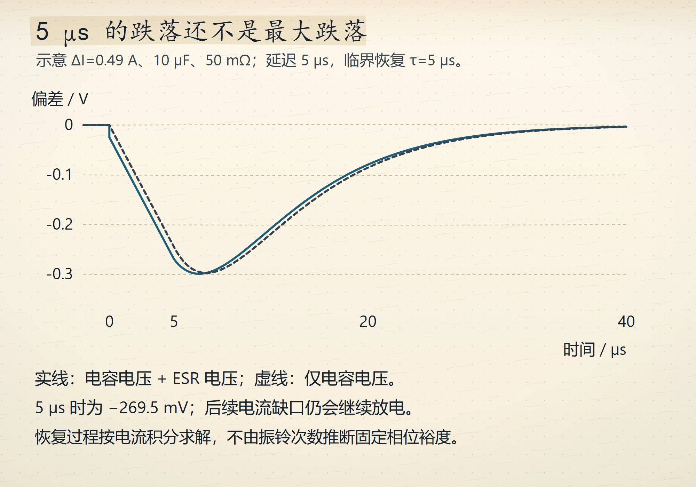

- 章·锚：9·9.5 ｜ 像素 diff vs 签名版：0.00%
- alt：总输出偏差与电容电压分开画，五微秒控制接管时尚未达到最大跌落，后续恢复从同一电容电流继续积分。
- source_facts：docs/p1-10-ch9.md#9.5

### ch09-reference-charge  ☐

当前：
签名版：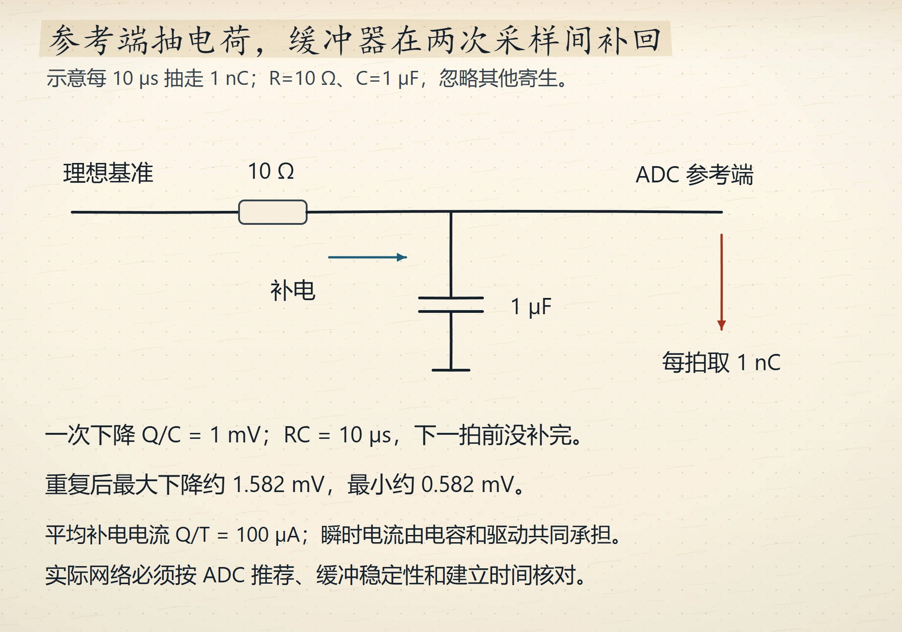

- 章·锚：9·9.1 ｜ 像素 diff vs 签名版：0.00%
- alt：参考缓冲串联十欧姆给一微法补电，ADC 每十微秒取一纳库仑；单次一毫伏的下降会因未完全恢复而累积。
- source_facts：docs/p1-10-ch9.md#9.1

### ch09-reference-ladder  ☐

当前：
签名版：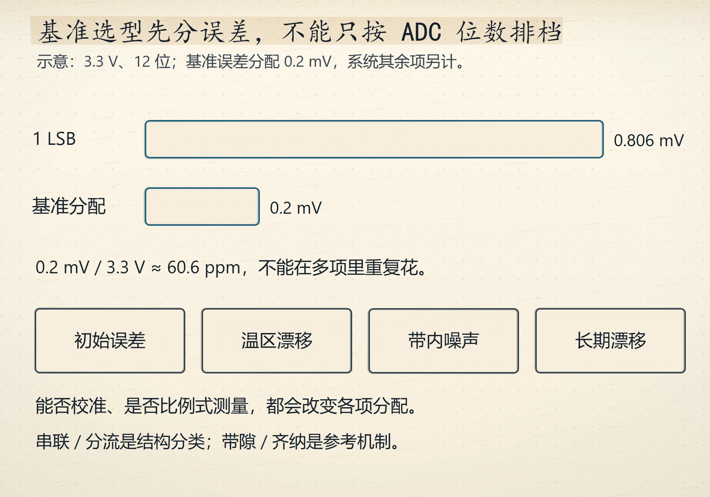

- 章·锚：9·9.1 ｜ 像素 diff vs 签名版：0.00%
- alt：三点三伏十二位的一个 LSB 为零点八零六毫伏，基准分配零点二毫伏；初始误差、温漂、噪声与长期漂移分别列项。
- source_facts：docs/p1-10-ch9.md#9.1

### ch09-shunt-corners  ☐

当前：
签名版：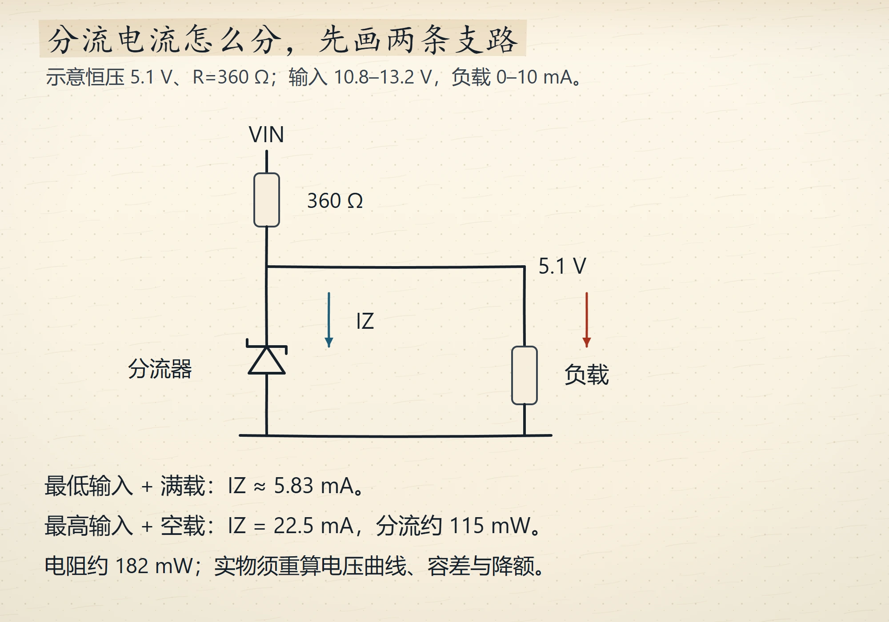

- 章·锚：9·9.1 ｜ 像素 diff vs 签名版：0.00%
- alt：限流电阻后电流分给负载与分流器；最低输入满载看最小分流电流，最高输入空载看器件与电阻功耗。
- source_facts：docs/p1-10-ch9.md#9.1

### ch09-thermal-path  ☐

当前：
签名版：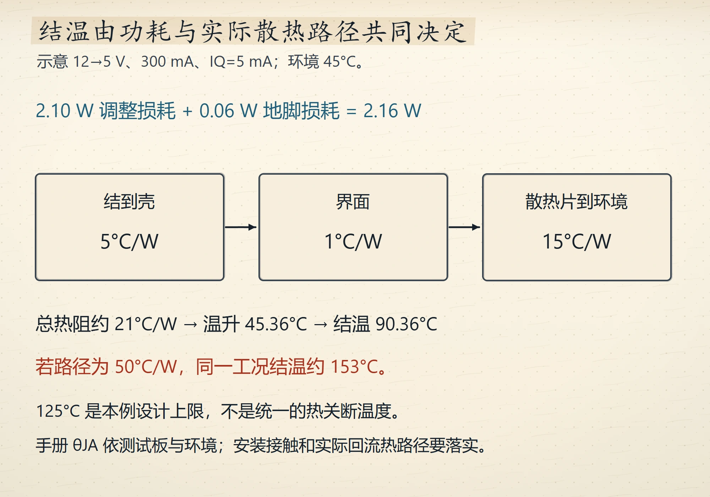

- 章·锚：9·9.3 ｜ 像素 diff vs 签名版：0.00%
- alt：结到壳、界面和散热片三个热阻串联为二十一度每瓦，完整功耗二点一六瓦，在四十五度环境得到约九十点三六度结温。
- source_facts：docs/p1-10-ch9.md#9.3

### ch09-tl431-divider-floor  ☐

当前：
签名版：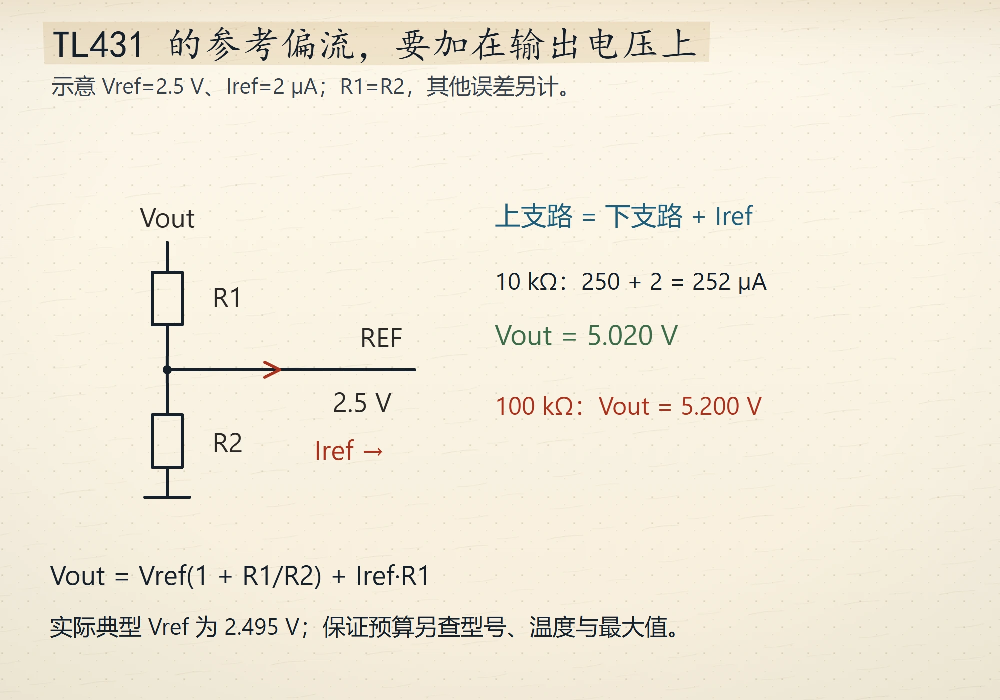

- 章·锚：9·9.2 ｜ 像素 diff vs 签名版：0.00%
- alt：参考端偏流流入芯片，上电阻电流为下电阻电流加偏流；示意两只十千欧给五点零二伏，百千欧给五点二伏。
- source_facts：docs/p1-10-ch9.md#9.2

### ch09-transient-budget  ☐

当前：
签名版：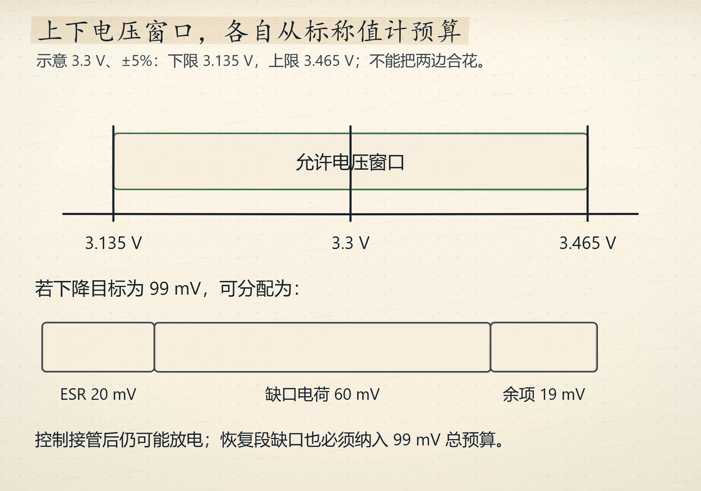

- 章·锚：9·9.5 ｜ 像素 diff vs 签名版：0.00%
- alt：三点三伏的上下各百分之五窗口分别核对；下降九十九毫伏预算分为 ESR 二十、缺口电荷六十、余项十九毫伏，后续恢复仍要计入。
- source_facts：docs/p1-10-ch9.md#9.5

### ch10-555-fault-tree  ☐

当前：
签名版：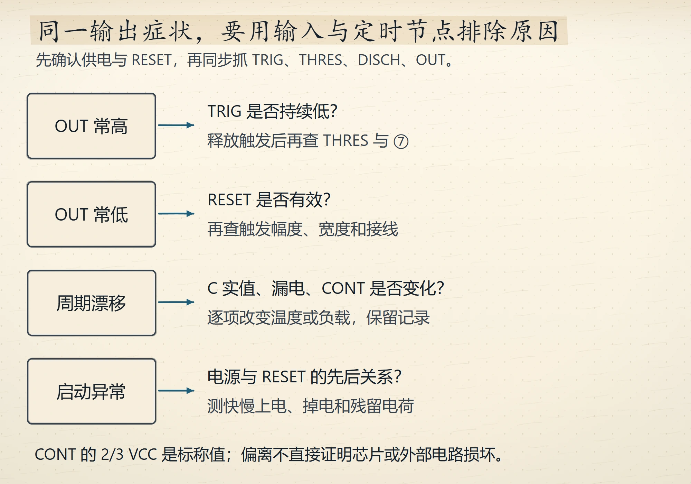

- 章·锚：10·10.3 ｜ 像素 diff vs 签名版：0.00%
- alt：输出常高先查触发，常低先查复位；漂移测实际电容漏电与控制节点，启动测供电和复位时序。
- source_facts：docs/p1-11-ch10.md#10.3

### ch10-555-modes  ☐

当前：
签名版：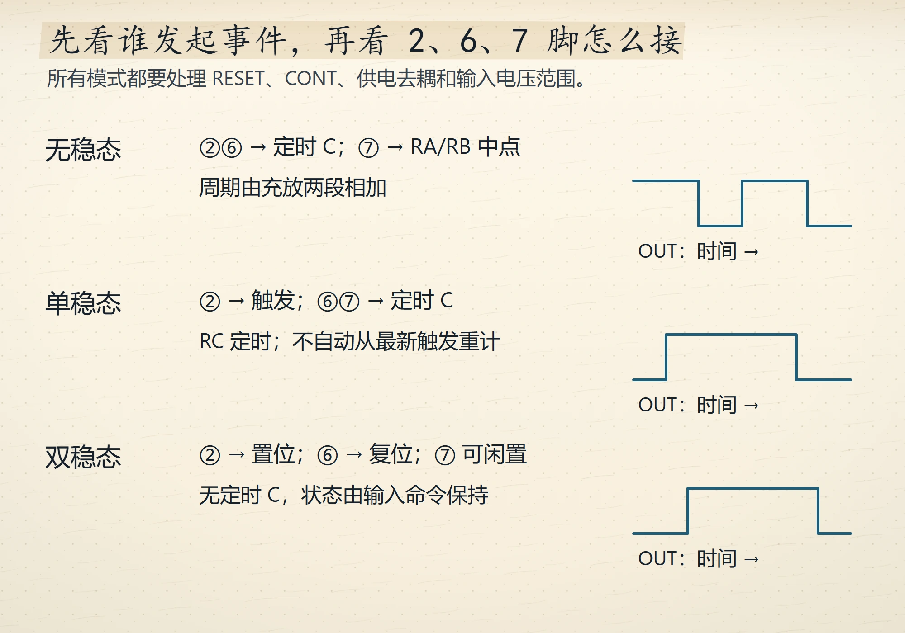

- 章·锚：10·10.2 ｜ 像素 diff vs 签名版：0.00%
- alt：无稳态将触发与阈值并到定时电容，单稳态另接触发，双稳态分别接受置位复位；各自连接和输出波形并列。
- source_facts：docs/p1-11-ch10.md#10.2

### ch10-555-threshold-clamp  ☐

当前：
签名版：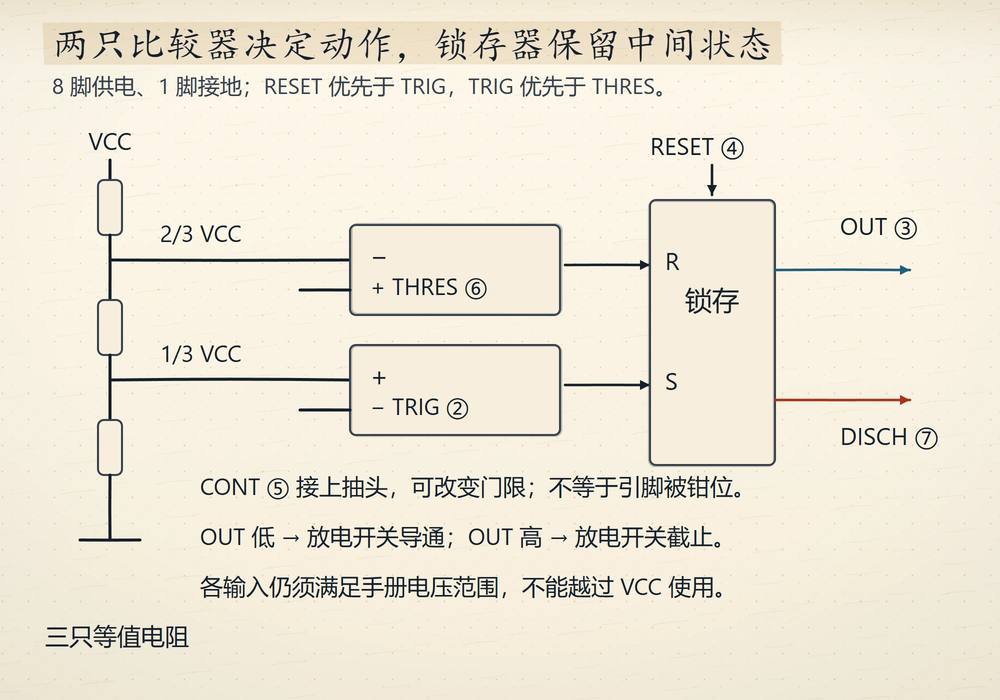

- 章·锚：10·10.1 ｜ 像素 diff vs 签名版：0.00%
- alt：三只等值电阻形成两门限，阈值比较器和触发比较器进入锁存器，RESET 具有最高优先级，OUT 与放电开关状态对应。
- source_facts：docs/p1-11-ch10.md#10.1

### ch10-astable-reverse-design  ☐

当前：
签名版：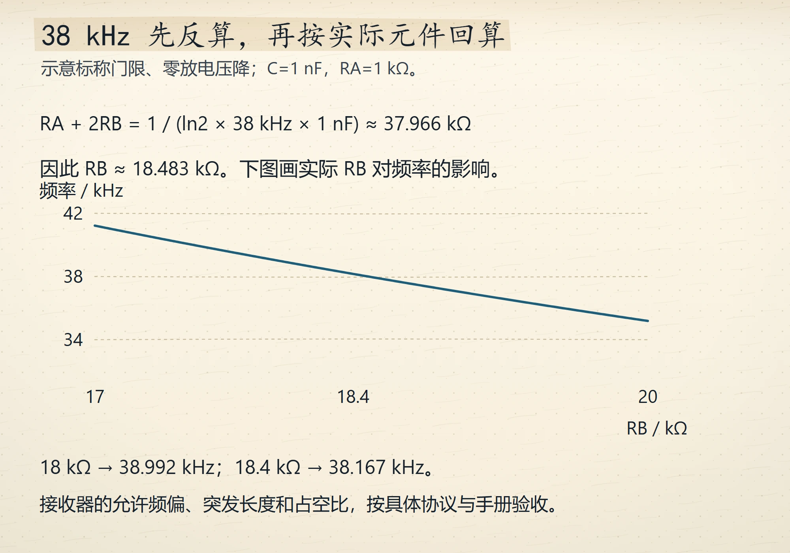

- 章·锚：10·10.4 ｜ 像素 diff vs 签名版：0.00%
- alt：三十八千赫和一纳法反求电阻和约三十七点九六六千欧，再用实际阻值重新核算频率与协议窗口。
- source_facts：docs/p1-11-ch10.md#10.4

### ch10-clock-gating  ☐

当前：
签名版：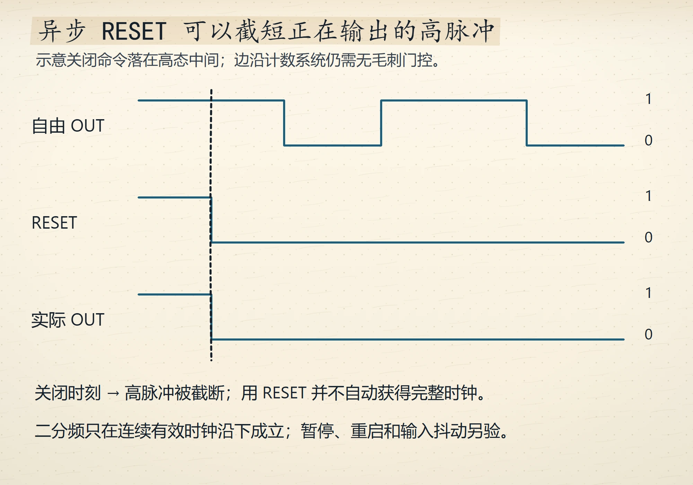

- 章·锚：10·10.4 ｜ 像素 diff vs 签名版：0.00%
- alt：关闭命令在高脉冲中段到达时，RESET 会把输出提前截断；关闭和重启都须按时钟接收器要求验收。
- source_facts：docs/p1-11-ch10.md#10.4

### ch10-discharge-current  ☐

当前：
签名版：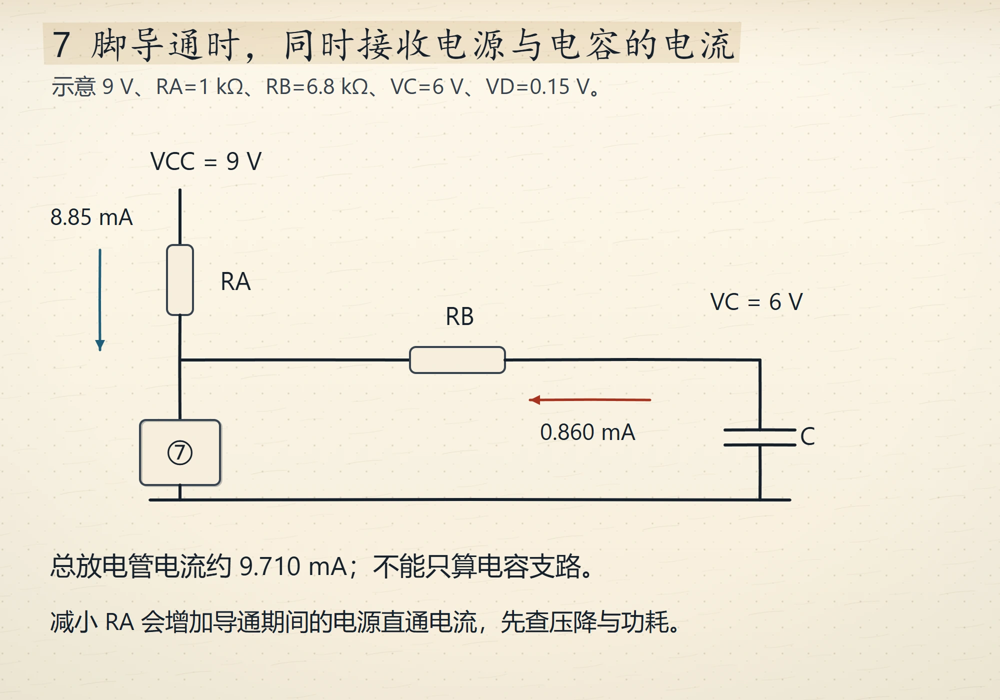

- 章·锚：10·10.1 ｜ 像素 diff vs 签名版：0.00%
- alt：电源经 RA 与电容经 RB 的电流一起进入七脚，示意八点八五与零点八六毫安相加，不能漏算电源电流。
- source_facts：docs/p1-11-ch10.md#10.1

### ch10-duty-fifty-paths  ☐

当前：
签名版：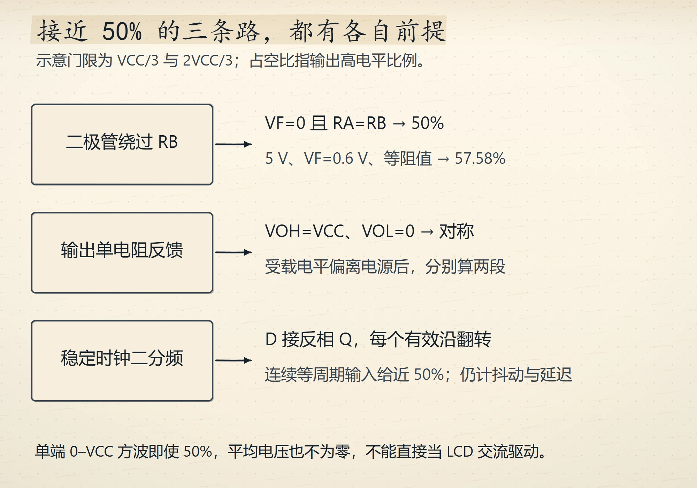

- 章·锚：10·10.4 ｜ 像素 diff vs 签名版：0.00%
- alt：二极管路径计入压降，输出反馈计入受载电平，数字分频计入连续有效时钟；单端方波平均电压不为零。
- source_facts：docs/p1-11-ch10.md#10.4

### ch10-logic-margin  ☐

当前：
签名版：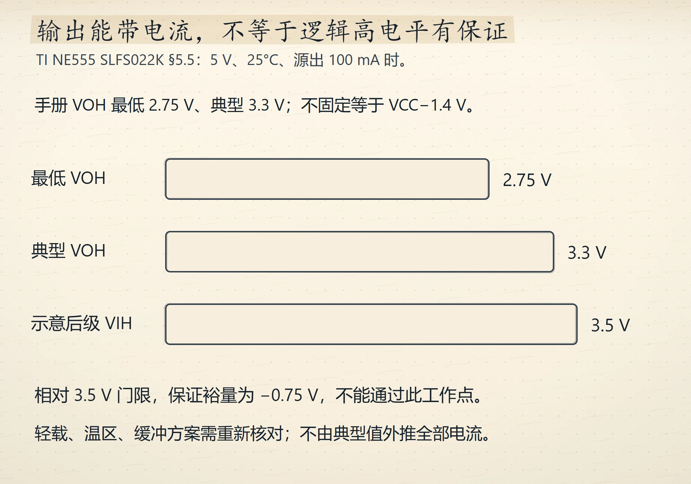

- 章·锚：10·10.3 ｜ 像素 diff vs 签名版：0.00%
- alt：特定五伏和一百毫安条件下，NE555 最低高电平二点七五伏，对示意三点五伏输入门限没有保证裕量。
- source_facts：docs/p1-11-ch10.md#10.3

### ch10-monostable-budget  ☐

当前：
签名版：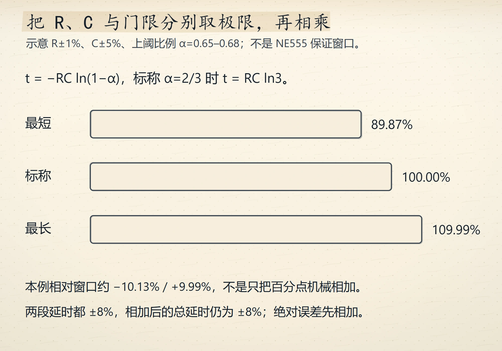

- 章·锚：10·10.5 ｜ 像素 diff vs 签名版：0.00%
- alt：示意电阻电容和门限范围取角点相乘，最短约标称八十九点八七百分比，最长约一百零九点九九百分比。
- source_facts：docs/p1-11-ch10.md#10.5

### ch10-recovery-gap  ☐

当前：
签名版：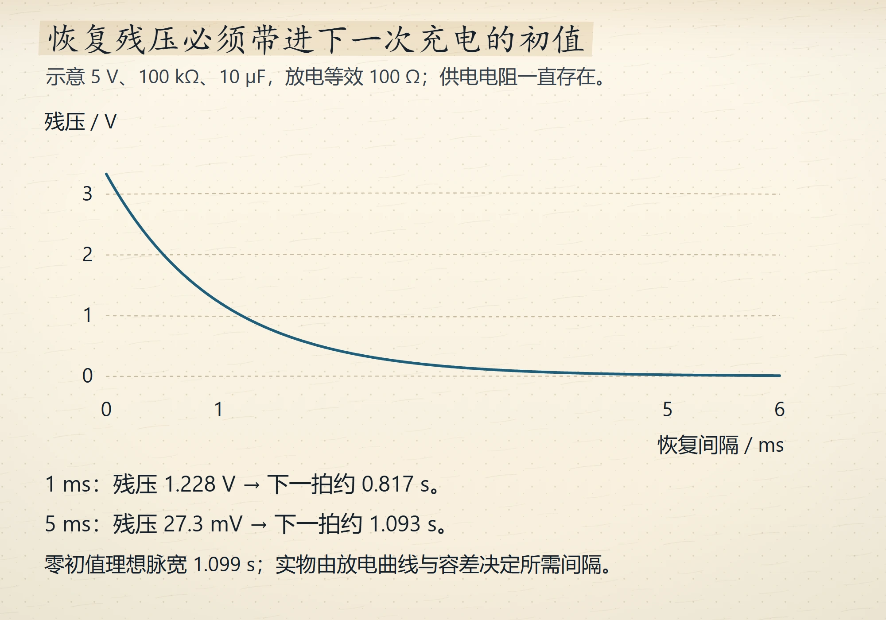

- 章·锚：10·10.5 ｜ 像素 diff vs 签名版：0.00%
- alt：放电等效电阻模型中保留电源馈入，一毫秒后残压一点二二八伏，五毫秒后二十七点三毫伏，下一拍各自重新计算。
- source_facts：docs/p1-11-ch10.md#10.5

### ch10-timer-leakage  ☐

当前：
签名版：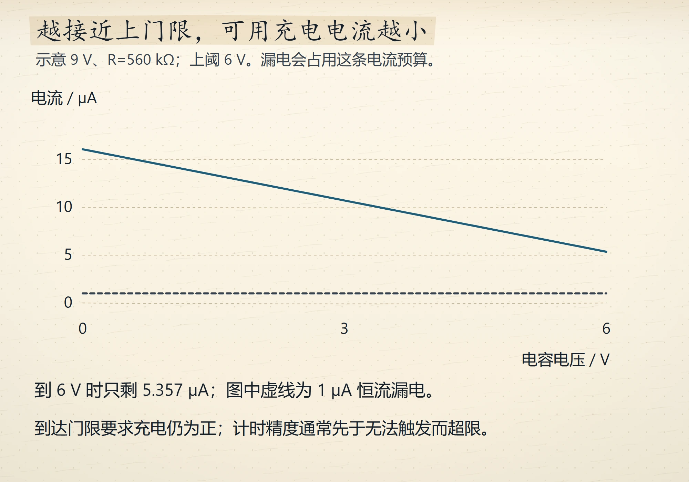

- 章·锚：10·10.5 ｜ 像素 diff vs 签名版：0.00%
- alt：电容电压越高，电阻充电电流越小；到上门限只剩五点三五七微安，漏电预算必须在此端点检查。
- source_facts：docs/p1-11-ch10.md#10.5

### ch11-cascode-headroom  ☐

当前：
签名版：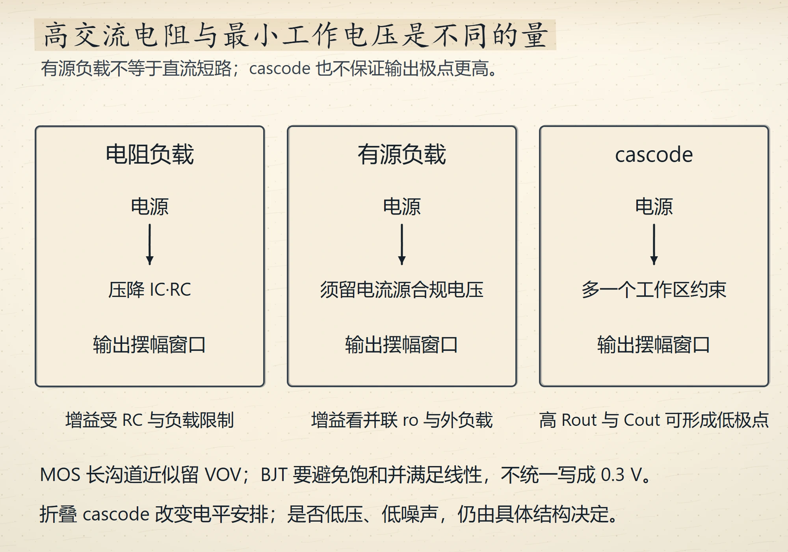

- 章·锚：11·11.8 ｜ 像素 diff vs 签名版：0.00%
- alt：三种负载分别显示电源到输出的电压预算，强调合规电压不同于实际直流压降，高输出电阻可降低输出极点。
- source_facts：docs/p2-01-ch11.md#11.8

### ch11-cmrr-definitions  ☐

当前：
签名版：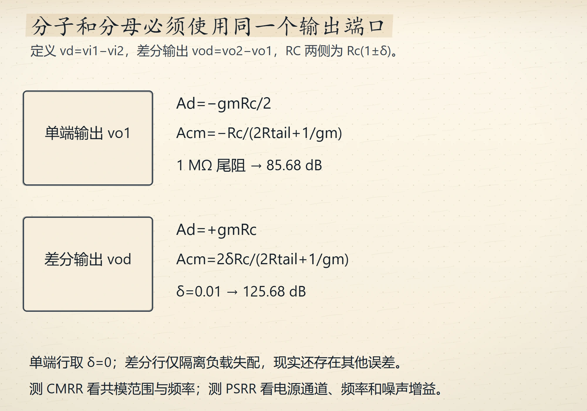

- 章·锚：11·11.9 ｜ 像素 diff vs 签名版：0.00%
- alt：单端与差分输出分别列差模增益和共模增益，只有分子分母使用同一输出端口才可相除。
- source_facts：docs/p2-01-ch11.md#11.9

### ch11-design-dc  ☐

当前：
签名版：

- 章·锚：11·11.11 ｜ 像素 diff vs 签名版：0.00%
- alt：三个模块列出偏置分压、发射极和集电极电阻、直流节点与耦合关系，输出管基流计入第二级集电极电阻。
- source_facts：docs/p2-01-ch11.md#11.11

### ch11-diffpair-four-beats  ☐

当前：
签名版：

- 章·锚：11·11.7 ｜ 像素 diff vs 签名版：0.00%
- alt：共模不改变理想尾电流，差模二十毫伏按双曲正切分配，单端与差分增益分开列，提醒线性误差与工作区。
- source_facts：docs/p2-01-ch11.md#11.7

### ch11-miller-bandwidth  ☐

当前：
签名版：

- 章·锚：11·11.5 ｜ 像素 diff vs 签名版：0.00%
- alt：输入一毫伏、输出负一百毫伏在十皮法电容上产生一点零一皮库仑电荷，列出 MOS 三电容和电流增益带宽的正确定义。
- source_facts：docs/p2-01-ch11.md#11.5

### ch11-mirror-three-errors  ☐

当前：
签名版：

- 章·锚：11·11.3 ｜ 像素 diff vs 签名版：0.00%
- alt：参考电流包含两份基流，Early 效应使不同输出电压下复制比改变，器件匹配与温度构成独立误差。
- source_facts：docs/p2-01-ch11.md#11.3

### ch11-noise-identify  ☐

当前：
签名版：

- 章·锚：11·11.6 ｜ 像素 diff vs 签名版：0.00%
- alt：五种症状各配一个频谱或工况检查，再决定改带宽、源阻或器件，保留信号与稳定性约束。
- source_facts：docs/p2-01-ch11.md#11.6

### ch11-noise-input-budget  ☐

当前：
签名版：

- 章·锚：11·11.6 ｜ 像素 diff vs 签名版：0.00%
- alt：一兆欧源的热噪声占本例总均方值约百分之九十九点四，横条按功率比例绘制，三项有效值分别列出后再做平方和开方。
- source_facts：docs/p2-01-ch11.md#11.6

### ch11-noise-three-taxes  ☐

当前：
签名版：

- 章·锚：11·11.10 ｜ 像素 diff vs 签名版：0.00%
- alt：三组源阻和等效噪声带宽分别计算热噪声与信噪比，长度表示有效值，说明不能靠衰减信号报告降噪。
- source_facts：docs/p2-01-ch11.md#11.10

### ch11-phase-margin-table  ☐

当前：
签名版：

- 章·锚：11·11.5 ｜ 像素 diff vs 签名版：0.00%
- alt：给出四十五、六十、六十五度在指定环路中的阻尼和过冲，禁止按极点数量直接判定稳定性。
- source_facts：docs/p2-01-ch11.md#11.5

### ch11-topology-ports  ☐

当前：
签名版：

- 章·锚：11·11.1 ｜ 像素 diff vs 签名版：0.00%
- alt：三行端口示意对照输入输出与交流公共端，标明共射反相、共集跟随、共基低输入阻抗，并说明阻抗随偏置与负载变化。
- source_facts：docs/p2-01-ch11.md#11.1

### ch11-two-stage-margin  ☐

当前：
签名版：

- 章·锚：11·11.11 ｜ 像素 diff vs 签名版：0.00%
- alt：原候选在一百欧负载下增益和驱动失败，修订候选仅按列出的标称模型通过，低贝塔输入电阻仍不合格。
- source_facts：docs/p2-01-ch11.md#11.11

### ch12-feedback-ports  ☐

当前：
签名版：

- 章·锚：12·12.7 ｜ 像素 diff vs 签名版：0.00%
- alt：四行比较受控量、输入混合、输出采样带来的阻抗方向，强调环路增益无量纲与模型适用条件。
- source_facts：docs/p2-02-ch12.md#12.7

### ch12-input-stage-source-z  ☐

当前：
签名版：

- 章·锚：12·12.13a ｜ 像素 diff vs 签名版：0.00%
- alt：两候选只代表给定参数，偏置电流乘源阻后分别为二十毫伏与一微伏；噪声包含电压、电流与热噪声。
- source_facts：docs/p2-02-ch12.md#12.13a

### ch12-input-types  ☐

当前：
签名版：

- 章·锚：12·12.13c ｜ 像素 diff vs 签名版：0.00%
- alt：互补输入、电荷泵与非轨到轨输入按具体器件曲线评估，避免把固定失真或温漂数字归给整个家族。
- source_facts：docs/p2-02-ch12.md#12.13c

### ch12-phase-crossing  ☐

当前：
签名版：

- 章·锚：12·12.7a ｜ 像素 diff vs 签名版：0.00%
- alt：原 A 一千乘零点一不是单位交越，改用 A 十倍乘零点一，再分别读取负一百二十与负一百七十度。
- source_facts：docs/p2-02-ch12.md#12.7a

### ch12-riso-feedback-point  ☐

当前：
签名版：

- 章·锚：12·12.9a ｜ 像素 diff vs 签名版：0.00%
- alt：输出阻抗后标记 A，隔离电阻后标记 B，电容从 B 接地；三种连接分别给出相位裕度，并提醒低裕度模型仍收敛。
- source_facts：docs/p2-02-ch12.md#12.9a

### ch12-sallen-key-network  ☐

当前：
签名版：

- 章·锚：12·12.5 ｜ 像素 diff vs 签名版：0.00%
- alt：R1、R2 串联，C1 由两电阻中点连接输出，C2 从运放正输入接地；跟随反馈接负端，列出 Butterworth 电容比。
- source_facts：docs/p2-02-ch12.md#12.5

### ch12-switch-cap  ☐

当前：
签名版：

- 章·锚：12·12.12c ｜ 像素 diff vs 签名版：0.00%
- alt：完整周期分成两次建立与非重叠段，半 LSB 比一 LSB 多一个 ln2 时间常数，同时计噪声、注入与混叠。
- source_facts：docs/p2-02-ch12.md#12.12c

### ch12-switched-cap-equivalent  ☐

当前：
签名版：

- 章·锚：12·12.12 ｜ 像素 diff vs 签名版：0.00%
- alt：两相把同一只电容轮流连接 V1 和 V2，每周期净搬运量由电压差决定，绝对电阻与电容比时间常数分别列式。
- source_facts：docs/p2-02-ch12.md#12.12

### ch12-tia-three-way  ☐

当前：
签名版：

- 章·锚：12·12.10a ｜ 像素 diff vs 签名版：0.00%
- alt：分开直流跨阻、噪声增益拐点与补偿初估，不再把十五点九千赫兹当信号截止或振荡频率。
- source_facts：docs/p2-02-ch12.md#12.10a

### ch14-ltspice-five  ☐

当前：
签名版：

- 章·锚：14·14.6 ｜ 像素 diff vs 签名版：0.54%
- alt：五步卡：.op 先看直流工作点，.dc 扫传输特性，.tran 看时域波形，.ac 量频域裕度，.step 扫参数与温度极限；顺序是先工作点后动态、先理想后真实。
- source_facts：docs/p3-01-ch14.md#14.6

### ch14-tolerance-three  ☐

当前：
签名版：

- 章·锚：14·14.10 ｜ 像素 diff vs 签名版：2.37%
- alt：左右两栏：WC 把三个 ±1% 同向相加得 3%，适合车规医疗；RSS 把 ±1% 按均匀分布折成 σ=0.577%，三项合成 1σ=1.0%、3σ=3.0%，适合消费类良率。
- source_facts：docs/p3-01-ch14.md#14.10

## C2 文本有变
### ch13-current-sense-sides  ☐

当前：
签名版：

- 章·锚：13·13.8 ｜ 像素 diff vs 签名版：24.40%
- alt：左右两栏：低侧检测共模接近 0 V、会把负载地抬高 100 mV、测不到对地短路，适合精度优先的单路负载；高侧检测共模为 12 或 24 或 48 V、地完整、能测对地短路，适合保护优先的多路共地负载。
- source_facts：docs/p2-03-ch13.md#13.8
- numΔ：+[] −['0', '100', '100', '12', '12', '24', '48', '48']

### ch13-h-bridge-states  ☐

当前：
签名版：

- 章·锚：13·13.7 ｜ 像素 diff vs 签名版：25.78%
- alt：左右两栏：左栏四拍是正转 Q1 与 Q4 导通、反转 Q2 与 Q3 导通、全关滑行时电感电流经体二极管回电源、同臂 Q1 与 Q2 齐开会毫秒级烧管；右栏是 1 到 2 微秒死区、体二极管兜底、高侧自举、DRV8833 或 L298 集成驱动。
- source_facts：docs/p2-03-ch13.md#13.7
- numΔ：+[] −['12', '298', '8833']

### ch13-opto-ctr  ☐

当前：
签名版：

- 章·锚：13·13.11 ｜ 像素 diff vs 签名版：23.84%
- alt：左右两栏：左栏三条隔离路线是光耦、数字隔离器、隔离放大器，共同点是没有欧姆通路；右栏 CTR 三个坑是分档 50% 到 600% 要按最小值、100 摄氏度与 20 毫安下十年可能掉一半、驱动至少留 2 倍余量，设计式为集电极电流等于正向电流乘 CTR。
- source_facts：docs/p2-03-ch13.md#13.11; docs/p2-03-ch13.md#13.11a
- numΔ：+['0.5'] −['-7840', '10', '10', '1201', '1301', '137', '2', '20', '521', '6', '600', '7721', '817', '817', '8620']

### ch14-dft-testpoints  ☐

当前：
签名版：

- 章·锚：14·14.8 ｜ 像素 diff vs 签名版：3.44%
- alt：左右两栏：左栏列应留测试点的位置与机械要求（TP 直径至少 1 mm、间距至少 2.54 mm、沉金）；右栏区分 ICT 抓连接、FCT 抓功能，高速节点改用测试过孔，量产用 50 到 100 块小批看分布。
- source_facts：docs/p3-01-ch14.md#14.8
- numΔ：+[] −['90']

### ch15-crosstalk-3w  ☐

当前：
签名版：

- 章·锚：15·15.3 ｜ 像素 diff vs 签名版：3.48%
- alt：左右两栏：左栏三招是拉开间距使容性耦合减半、3W 规则把串扰压到 5% 以下、缩短平行长度并用 5 到 10 毫米间距的地孔栅栏包地；右栏边界是地线必须低阻、线宽至少为被保护线两倍、包地只防电场耦合，磁场耦合要靠缩环路或拉距离。
- source_facts：docs/p3-02-ch15.md#15.3
- numΔ：+[] −['2', '6']

### ch15-via-parallel  ☐

当前：
签名版：

- 章·锚：15·15.3 ｜ 像素 diff vs 签名版：21.08%
- alt：纸层量级图：单个 0.3 毫米过孔约 1.3 纳亨，四个并联约 0.25 纳亨，3 安培换层至少 3 只；信号过孔每孔都带寄生，应少打并成对打。
- source_facts：docs/p3-02-ch15.md#15.3
- numΔ：+['0', '0.325', '0.812', '1.299', '2', '4'] −['0.25', '1.3', '1.3', '1.5', '3', '3', '3']
